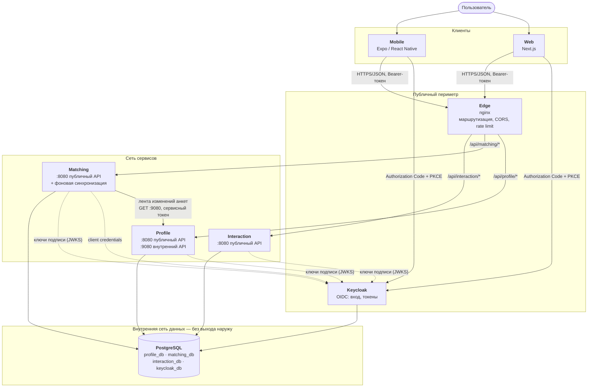
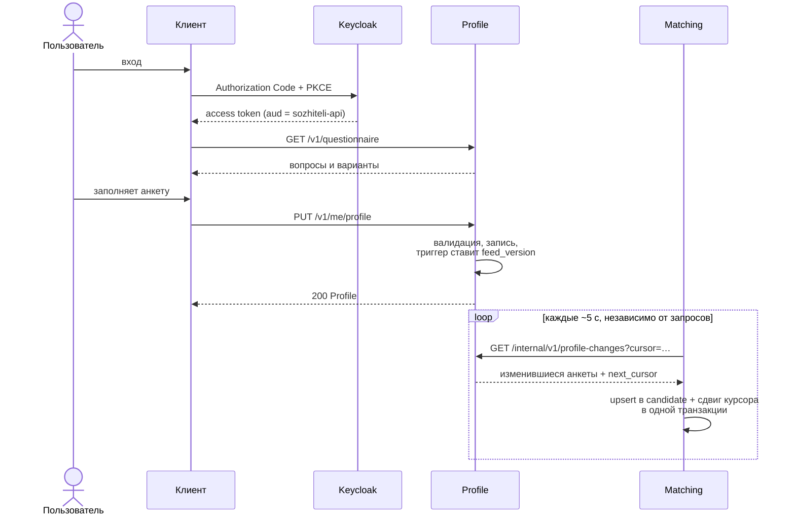
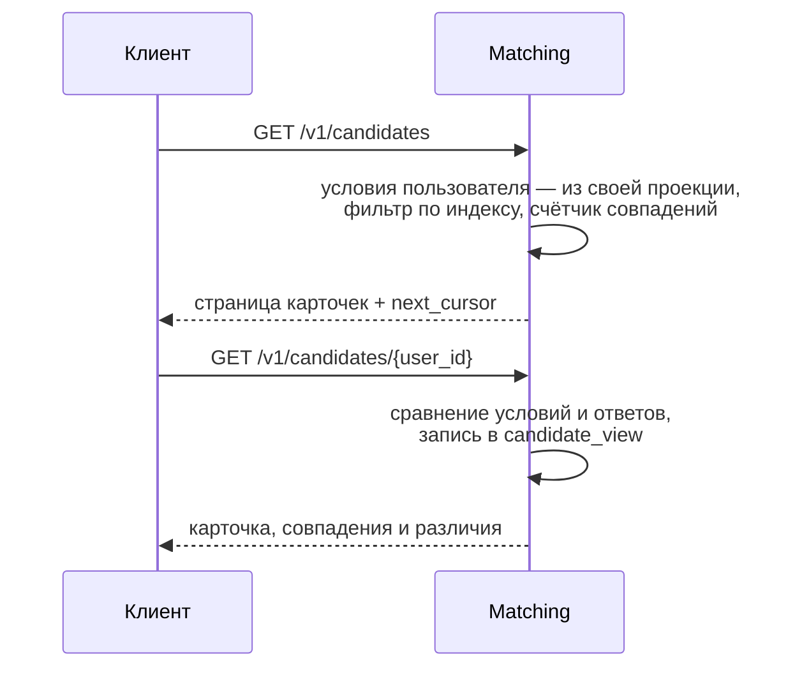

# Сожители

Сервис поиска соседа для совместной аренды жилья. Пользователь заполняет анкету — город, бюджет,
сроки заселения, предпочтение по полу соседа и восемь вопросов о бытовых привычках, — видит
подходящих по условиям людей со сравнением привычек и обменивается контактами (Telegram или
ВКонтакте) только по взаимному согласию.

Документ описывает техническую часть: архитектуру, данные, API, безопасность, запуск и
размещение.

## Содержание

1. [Стек](#1-стек)
2. [Архитектура](#2-архитектура)
3. [Сервисы](#3-сервисы)
4. [Данные](#4-данные)
5. [Сценарии](#5-сценарии)
6. [API](#6-api)
7. [Безопасность](#7-безопасность)
8. [Устойчивость и наблюдаемость](#8-устойчивость-и-наблюдаемость)
9. [Производительность и масштабирование](#9-производительность-и-масштабирование)
10. [Архитектурные решения](#10-архитектурные-решения)
11. [Клиенты](#11-клиенты)
12. [Репозиторий и правила разработки](#12-репозиторий-и-правила-разработки)
13. [Запуск локально](#13-запуск-локально)
14. [Тестирование](#14-тестирование)
15. [Размещение на сервере](#15-размещение-на-сервере)
16. [Инструменты](#16-инструменты)

## 1. Стек

| Часть | Технологии | Версия |
|---|---|---|
| Backend | Go, chi, pgx, sqlc, oapi-codegen, goose | Go 1.27, oapi-codegen 2.8.0, sqlc 1.31.1 |
| База данных | PostgreSQL | 18.6 |
| Вход и токены | Keycloak (OIDC) | 26.8.1 |
| Edge-прокси | nginx | 1.30.5 |
| Web | Next.js, React, TypeScript | 16.4.0, 19.2.3, 6.0.3 |
| Mobile | Expo, React Native, TypeScript | SDK 57, 0.86.3 |
| Контракты | OpenAPI 3.0, Redocly, openapi-typescript, openapi-fetch | — |
| Инфраструктура | Docker, Docker Compose, Caddy (на сервере) | Caddy 2.10.2 |
| Проверки | golangci-lint, ESLint, Prettier, Vitest, k6 | golangci-lint 2.14.0, k6 2.3.0 |

Node.js 24. Зависимости зафиксированы в `go.sum` и `package-lock.json`.

## 2. Архитектура

Три независимо развёртываемых сервиса на Go, у каждого своя база данных; готовый
OIDC-провайдер; транспортный edge-прокси; два клиентских приложения, работающих через
сгенерированный из контрактов клиент.

| Компонент | Ответственность | Технология |
|---|---|---|
| **Profile** | Анкета пользователя: условия и ответы о привычках; справочник городов | Go |
| **Matching** | Выдача кандидатов и сравнение анкет на собственной копии данных | Go |
| **Interaction** | Контакт пользователя и запросы на обмен контактами | Go |
| **Keycloak** | Регистрация, вход, выпуск токенов | готовое решение |
| **Edge** | Единая точка входа в API: маршрутизация, CORS, ограничение частоты | nginx |
| **PostgreSQL** | Один экземпляр, отдельная база и роли на каждый сервис | PostgreSQL 18 |
| **Web** | Веб-клиент | Next.js |
| **Mobile** | Клиент Android и iOS | Expo |



Ключевые свойства:

- **Единственная межсервисная зависимость — Matching → Profile**, и она фоновая: при обработке
  пользовательского запроса ни один сервис не вызывает другой. Циклов нет.
- **Interaction не зависит ни от кого.**
- Edge не подключён к сети данных; внутренний порт Profile (9080) через edge не маршрутизируется.
- Каждый сервис проверяет токен сам; edge токены не проверяет.
- Данные двух сервисов в одном экране соединяет клиент по `user_id`.

### Чего в архитектуре нет

| Не используется | Почему | Когда пересмотреть |
|---|---|---|
| Монолит | Требование задания: сервисная архитектура | — |
| API Gateway с логикой, BFF | Нет агрегации, которую нельзя сделать на клиенте; edge — только транспорт | Экран, которому нужно 3+ последовательных вызова на медленной сети |
| Брокер сообщений | Один потребитель одной ленты; опроса по HTTP достаточно | Второй потребитель ленты или отставание проекции выше цели |
| Redis, кэш | Нет измеренной задержки, которую он бы устранил | Профилирование покажет повторяющиеся дорогие чтения |
| Elasticsearch | Фильтр выдачи — равенство и пересечение диапазонов, обслуживается индексом PostgreSQL | Полнотекстовый или гео-поиск |
| Kubernetes, service mesh | Три сервиса и одна база запускаются Compose | Несколько машин и автоматическое масштабирование |
| CQRS, Event Sourcing | Проекция Matching — копия состояния, а не журнал событий | — |
| Распределённые транзакции | Ни одна операция не меняет данные двух сервисов | — |
| gRPC | Одна внутренняя операция; HTTP+OpenAPI даёт тот же типизированный клиент | Высокочастотные межсервисные вызовы |

## 3. Сервисы

| | Profile | Matching | Interaction |
|---|---|---|---|
| **Отвечает на вопрос** | «Что человек рассказал о себе?» | «Кто мне подходит и чем мы отличаемся?» | «Кто с кем согласился обменяться контактами?» |
| **Источник истины для** | анкет, определения анкеты привычек, справочника городов | фактов просмотра карточек | контактов, запросов на контакт |
| **Хранит копию** | — | анкет (проекция, только чтение) | — |
| **Зависит от** | — | Profile (фоново) | — |
| **Нагрузка** | редкая запись и чтение | частое чтение, вычисление | транзакционная запись, чувствительные данные |
| **База** | `profile_db` | `matching_db` | `interaction_db` |

**Profile** хранит анкету и отдаёт её владельцу; проверяет её (определение анкеты привычек,
диапазоны, совершеннолетие, отсутствие ссылок и адресов в текстовых полях); отдаёт анкету
привычек и справочник городов; публикует ленту изменений анкет на внутреннем порту 9080.
Не отдаёт чужие анкеты, не хранит контакты, не фильтрует и не сравнивает анкеты, не знает о
других сервисах.

**Matching** поддерживает проекцию анкет (фоновый процесс читает ленту Profile и применяет её к
таблице `candidate`), отдаёт выдачу кандидатов, прошедших обязательные условия, сравнивает
условия и ответы, фиксирует просмотры карточек. Не изменяет анкеты (проекцию можно удалить и
построить заново), не обращается к Profile в пользовательском запросе, не знает о контактах,
сравнивает коды ответов, а подписи клиент берёт у Profile.

**Interaction** хранит контакт владельца; создаёт запросы на контакт (проверки: контакт у
отправителя, суточный лимит, нет повторного и встречного запроса); принимает и отклоняет
запросы; раскрывает контакт второго участника **только** в запросе со статусом `accepted`.
Не знает анкет, не отправляет уведомлений, не вызывает другие сервисы.

**Keycloak** владеет учётными записями, паролями и сессиями; сервисы получают от него только
подписанные токены и открытые ключи. **Edge** — транспорт без логики: маршрутизация
`/api/<service>/…`, CORS, ограничение частоты по IP, единый формат собственных ошибок.

Как клиент собирает экраны:

| Экран | Вызовы |
|---|---|
| Анкета | Profile: `getQuestionnaire`, `listCities`, `getMyProfile`, `putMyProfile` |
| Контакт | Interaction: `getMyContact`, `putMyContact` |
| Выдача | Matching: `listCandidates` |
| Карточка кандидата | Matching: `getCandidate`; Profile: `getQuestionnaire` (подписи); Interaction: `listContactRequests?counterpart_id=…` |
| Запросы на контакт | Interaction: `listContactRequests`; Matching: `lookupCandidates` (карточки собеседников) |

Куда относится новая функция: меняет анкету — Profile; меняет запрос или контакт —
Interaction; только читает и вычисляет над анкетами многих людей — Matching; нужны данные двух
сервисов в одном ответе — соединяет клиент. Изменение данных двух сервисов одной операцией
требует отдельного архитектурного решения.

## 4. Данные

### Владение

У каждой единицы данных один владелец — сервис, который один может её изменять. Изоляция
физическая:

| Сервис | База | Роль миграций (владелец схемы) | Рабочая роль (только строки) |
|---|---|---|---|
| Profile | `profile_db` | `profile_migrator` | `profile_app` |
| Matching | `matching_db` | `matching_migrator` | `matching_app` |
| Interaction | `interaction_db` | `interaction_migrator` | `interaction_app` |
| Keycloak | `keycloak_db` | `keycloak_app` | `keycloak_app` |

Запросов между базами в PostgreSQL нет, поэтому `JOIN` с чужой таблицей невозможен. Рабочая
роль не подключается к чужой базе и не меняет схему своей. Роли и базы создаёт
`deploy/compose/postgres/init/10-databases.sh`; изоляцию проверяет `npm run infra:smoke`.

### Таблицы

| База | Таблица | Содержимое |
|---|---|---|
| `profile_db` | `profile` | Анкета: имя, год рождения, пол, род занятий, город, районы, бюджет, сроки, предпочтение по полу соседа, ответы о привычках, статус поиска |
| | `profile_deletion` | Отметки об удалённых анкетах для ленты изменений |
| | `city` | 1117 городов России с регионом (данные HFLabs, CC BY-SA 4.0); идентификаторы неизменны |
| `matching_db` | `candidate` | **Копия** анкет из Profile; изменяется только применением ленты |
| | `sync_state` | Позиция чтения ленты |
| | `candidate_view` | Просмотры карточек: кто, кого, сколько совпало, когда |
| `interaction_db` | `contact` | Контакт пользователя: Telegram или ВК — самые чувствительные данные системы |
| | `contact_request` | Запрос на контакт: отправитель, получатель, статус, время |
| `keycloak_db` | — | Учётные записи, email, хэши паролей, сессии (схемой управляет Keycloak) |

Определение анкеты привычек (вопросы, варианты, версии) хранится в коде Profile:
`internal/questionnaire`. Служебные столбцы `profile.updated_at` и `profile.feed_version`
выставляет триггер `profile_touch`, удаление записывает в `profile_deletion` триггер
`profile_record_deletion` — приложение их не пишет, поэтому любое изменение анкеты попадает в
ленту.

### Идентификатор пользователя

Пользователь во всех сервисах — `user_id uuid`, равный claim `sub` access-токена. Это единственное,
что связывает данные одного человека в разных сервисах; внешних ключей между сервисами нет.
Сервис берёт `user_id` вызывающего только из токена (`auth.UserID(ctx)`).

### Лента изменений Profile → Matching

| Свойство | Значение |
|---|---|
| Направление | Matching запрашивает у Profile `GET /internal/v1/profile-changes`; Profile о Matching не знает |
| Что передаётся | Текущее состояние изменившихся анкет целиком и отметки об удалении. Контактов и данных Keycloak нет |
| Версия записи | `feed_version = pg_current_xact_id()` транзакции, изменившей строку |
| Гарантии | Без пропусков: запись отдаётся, только когда завершены все транзакции с меньшей версией (горизонт `pg_snapshot_xmin`). Повторы возможны — Matching применяет идемпотентно, сравнивая версии |
| Применение | Страница и сдвиг курсора — в одной транзакции; курсор сдвигается сравнением (CAS), поэтому работает с несколькими репликами Matching |
| Задержка | До `SYNC_INTERVAL` (5 с). Пока анкеты нет в проекции, выдача отвечает `409 profile_not_ready` с `Retry-After` |
| Ошибки | Повтор с растущей паузой до 1 минуты; курсор не сдвигается |

Проекцию можно пересоздать: `TRUNCATE candidate; UPDATE sync_state SET feed_cursor = ''`.

### Изменение схемы

1. Только миграциями сервиса-владельца: новый файл `NNNNN_описание.sql` в `migrations/`;
   применённые файлы не редактируются.
2. У каждой миграции есть `-- +goose Down`; применение, откат и повторное применение проверяет
   интеграционный тест.
3. Миграции выполняются отдельным шагом (`<service> migrate up`) под ролью `<service>_migrator`
   до запуска новой версии сервиса.
4. Изменение совместимо с работающей предыдущей версией (expand → migrate → contract).
5. Схема базы — не контракт: типы ответов генерируются из OpenAPI, а не из таблиц. Изменение
   состава ленты (`ProfileSnapshot`) — изменение контракта.

### Удаление данных пользователя

Ручная операция оператора, `:id` — идентификатор пользователя:

```sql
-- 1. interaction_db
DELETE FROM contact_request WHERE sender_id = :id OR recipient_id = :id;
DELETE FROM contact WHERE user_id = :id;
-- 2. profile_db: отметку для ленты создаст триггер, копия исчезнет из Matching сама
DELETE FROM profile WHERE user_id = :id;
-- 3. matching_db
DELETE FROM candidate_view WHERE viewer_id = :id OR candidate_id = :id;
```

Затем удалить учётную запись в консоли Keycloak.

## 5. Сценарии

### Сохранение анкеты и появление в выдаче



### Выдача и сравнение



Обязательные условия выдачи: один город, пересекающиеся бюджеты, пересекающиеся сроки
заселения и взаимно допустимый пол соседа. Привычки сравниваются по кодам ответов: совпадает,
различается или не с чем сравнить.

### Запрос на контакт и раскрытие контакта

```mermaid
sequenceDiagram
    actor A as Отправитель
    actor B as Получатель
    participant I as Interaction
    participant M as Matching

    A->>I: POST /v1/contact-requests {recipient_id}
    I->>I: контакт у A, суточный лимит,<br/>нет запроса или встречного запроса
    I-->>A: 201, status = pending (контакта B нет)

    B->>I: GET /v1/contact-requests?direction=incoming
    I-->>B: запросы с counterpart_id
    B->>M: POST /v1/candidates/lookup {user_ids}
    M-->>B: карточки отправителей
    B->>I: POST /v1/contact-requests/{id}/accept
    I->>I: контакт у B, status → accepted
    I-->>B: запрос + контакт A
    A->>I: GET /v1/contact-requests?direction=outgoing
    I-->>A: запрос accepted + контакт B
```



Встречные запросы одной пары сериализуются advisory-блокировкой пары в транзакции, поэтому
создаётся ровно один.

## 6. API

Источник истины — файлы `contracts/openapi/`. Код сервера, типы клиента и проверка запросов
генерируются из них.

| Контракт | Сервис | Доступ | Адрес через edge |
|---|---|---|---|
| `profile.v1.yaml` | Profile | публичный | `/api/profile` |
| `matching.v1.yaml` | Matching | публичный | `/api/matching` |
| `interaction.v1.yaml` | Interaction | публичный | `/api/interaction` |
| `profile-internal.v1.yaml` | Profile | внутренний | `http://profile:9080`, только сеть сервисов |

| Операция | Метод и путь |
|---|---|
| **Profile** | |
| `getQuestionnaire` | `GET /v1/questionnaire` |
| `listCities` | `GET /v1/cities` |
| `getMyProfile`, `putMyProfile` | `GET`/`PUT /v1/me/profile` |
| **Profile, внутренний** | |
| `listProfileChanges` | `GET /internal/v1/profile-changes` |
| **Matching** | |
| `listCandidates` | `GET /v1/candidates` |
| `getCandidate` | `GET /v1/candidates/{user_id}` |
| `lookupCandidates` | `POST /v1/candidates/lookup` |
| **Interaction** | |
| `getMyContact`, `putMyContact` | `GET`/`PUT /v1/me/contact` |
| `createContactRequest` | `POST /v1/contact-requests` |
| `listContactRequests` | `GET /v1/contact-requests` |
| `acceptContactRequest`, `declineContactRequest` | `POST /v1/contact-requests/{id}/accept`, `/decline` |

Каждая операция помечена `x-implementation-status` (`implemented` или `planned` — тогда сервер
отвечает `501`); тест `TestImplementationStatusMatchesBehaviour` проверяет соответствие. Сейчас
реализованы все.

### Общие правила

- JSON, UTF-8, поля `snake_case`. Время — RFC 3339 в UTC, дата — `YYYY-MM-DD`, идентификаторы —
  UUID, деньги — целые рубли. `null` — только там, где схема объявляет `nullable`.
- `Authorization: Bearer <token>` обязателен везде. Публичные API — аудитория `sozhiteli-api`;
  внутренний — `sozhiteli-internal` и роль `internal.profile-changes.read`.
- `X-Request-Id` (8–64 символа `A-Z a-z 0-9 - _`) принимается от клиента или создаётся сервисом,
  возвращается в заголовке и в поле `request_id` ошибки.
- Пагинация только курсорная: `limit`, `cursor` → `items`, `next_cursor` (`null` — страниц больше
  нет). Курсор непрозрачен; общего количества в ответах нет.
- Версия — в пути (`/v1/…`). Совместимо: новая операция, новое необязательное поле запроса,
  новое поле ответа. Несовместимо (только через `v2`): удаление и переименование, смена типа или
  смысла, новое обязательное поле, добавление значения в перечисление ответа. Клиенты
  игнорируют неизвестные поля.
- Модели БД через API не раскрываются: типы ответов (`api.gen.go`) и строк БД (`store`) — разные
  типы, обработчик явно преобразует одно в другое.

### Коды ответов и ошибки

| Код | Когда | `code` |
|---|---|---|
| `200` / `201` | Успех / создан запрос на контакт | — |
| `400` | Запрос не соответствует схеме (проверка до обработчика) | `invalid_request` |
| `401` | Нет токена или он недействителен | `unauthorized` |
| `403` | Недостаточно прав (только внутренний API) | `forbidden` |
| `404` | Ресурс не найден; чужой запрос на контакт тоже `404` | `profile_not_found` и т. п. |
| `409` | Противоречит текущему состоянию | `request_exists`, `profile_not_ready` и т. п. |
| `422` | Нарушено бизнес-правило | `validation_failed` + `errors[]` |
| `429` | Превышен лимит, `Retry-After` | `rate_limited` |
| `500` | Непредвиденная ошибка, без подробностей | `internal_error` |
| `503` / `504` | Перегрузка или недоступность / серверный таймаут | `service_unavailable` / `request_timeout` |

Все ошибки сервисов и edge — `application/problem+json` (RFC 9457):

```json
{
  "type": "urn:sozhiteli:problem:validation_failed",
  "title": "Unprocessable Entity",
  "status": 422,
  "code": "validation_failed",
  "detail": "request violates validation rules",
  "request_id": "9f1c2a7e4b0d4c61a3e58f2b7d6c9e10",
  "errors": [
    { "field": "budget_max_rub", "code": "less_than_min", "message": "budget_max_rub must not be less than budget_min_rub" }
  ]
}
```

Клиент ветвится по `code`; `title` и `detail` — для разработчика. Правило, выразимое в OpenAPI
(`maxLength`, `enum`, `minimum`), записывается в контракт и не дублируется в коде.

### Изменение контракта

1. Изменить YAML в `contracts/openapi/` и выполнить `npm run contracts:lint`.
2. `npm run gen` — обновятся Go-интерфейсы и TypeScript-типы; новая операция появится как метод
   `StrictServerInterface`, до реализации возвращающий `problem.NotImplemented()`.
3. Контракт и сгенерированный код коммитятся вместе; CI (`gen:check`) падает при расхождении.

На клиенте API вызывается только через типизированный клиент; прямой `fetch` запрещён линтером:

```ts
const api = useApi(); // apps/web/src/lib/api.ts, apps/mobile/src/lib/api.ts
const { data, error } = await api.profile.GET('/v1/questionnaire');
if (error) {
  // error: Problem, ветвление по error.code
}
```

## 7. Безопасность

### Аутентификация и авторизация

- Пароли, регистрация и защита от перебора — только в Keycloak; в сервисах нет кода, работающего
  с паролями, и собственной криптографии.
- Клиенты — публичные OIDC-клиенты, Authorization Code + PKCE (S256); implicit flow и вход по
  паролю для них выключены. Регистрация — только почта и пароль (не короче 8 символов, не
  совпадает с почтой); страницы входа — своя тема Keycloak на русском.
- Access token — JWT на 5 минут, refresh-токены одноразовые. Сервисы проверяют подпись,
  издателя, срок и аудиторию (`backend/platform/auth`, go-oidc).
- Авторизация «только своё»: операция адресована `/me/…` либо проверяет участие вызывающего.
  Параметров «от чьего имени» в API нет.
- Web хранит токены в `sessionStorage`; mobile — refresh-токен в защищённом хранилище устройства
  (`expo-secure-store`), access token в памяти.
- Межсервисный вызов: Matching получает токен по client credentials (аудитория
  `sozhiteli-internal`, роль `internal.profile-changes.read`). Пользовательский токен на
  внутреннем API отклоняется, сервисный без роли получает `403`; порт 9080 наружу не
  публикуется.

### Правило раскрытия контакта

Контакт человека виден другому пользователю, только если между ними есть запрос на контакт, его
статус `accepted` и запрашивающий — один из двух участников. Следствия:

- открытие карточки контакт не раскрывает — у Matching контактов нет;
- у `pending` и `declined` запросов поля `counterpart_contact` нет ни у одной стороны;
- контакт берётся из `contact` в момент чтения и в `contact_request` не копируется;
- операции «получить контакт по идентификатору» нет;
- отправить и принять запрос может только пользователь со своим контактом — обмен всегда
  взаимный.

Свободный текст анкеты (`display_name`, `occupation`, `districts`) отклоняется (`422`), если
содержит `@`, `http`, `www.`, `t.me`, `vk.com`, `wa.me` или семь и более цифр подряд — барьер от
публикации контактов в обход правила.

### Угрозы и меры

| Угроза | Мера |
|---|---|
| Доступ к чужим данным подменой идентификатора | Идентификатор только из токена |
| Получение чужого контакта без согласия | Правило раскрытия, тесты на каждый статус |
| Массовый сбор контактов | Суточный лимит запросов (`CONTACT_REQUEST_DAILY_LIMIT`, 20) |
| Перебор и перегрузка API | Ограничение частоты по IP на edge (20 запросов/с, всплеск 40); предел одновременных запросов в сервисе |
| Поддельный токен; пользовательский токен на внутреннем API | Проверка подписи, издателя, срока, аудитории; роль; отдельный порт |
| SQL-инъекция | Только параметризованные запросы sqlc |
| Некорректный ввод | Проверка каждого запроса по OpenAPI до обработчика; тело до 64 КБ |
| Утечка через логи и ошибки | В логах нет тел, заголовков, query string и значений полей; непредвиденная ошибка — безличный `500` |
| Доступ к БД в обход сервисов | PostgreSQL во внутренней сети без опубликованного порта; отдельные базы и роли; у рабочих ролей нет DDL |
| XSS и кража токена в браузере | Content-Security-Policy с nonce на каждый запрос (`apps/web/src/proxy.ts`): скрипты и стили только приложения, инлайновые `style` запрещены правилом линтера, сетевые запросы только к API и провайдеру входа |

### Логи и секреты

- В логах разрешены метод, путь, статус, длительность, `request_id`, `user_id`, имя сервиса.
  Запрещены тела запросов и ответов, `Authorization`, токены, cookies, контакты, значения полей
  анкеты, query string, строки подключения.
- Секреты — только из переменных окружения. `deploy/compose/.env.example` содержит значения
  `dev-only-*` для локальной среды; на сервере пароли генерирует `init-secrets.sh`.
- У каждого сервиса свой пароль БД; пароль роли миграций работающему сервису не передаётся.
- Образы сервисов — distroless, процесс не от root; контейнеры с файловой системой только для
  чтения и `cap_drop: ALL`.
- `NEXT_PUBLIC_*` и `EXPO_PUBLIC_*` видны всем: секретов в них нет.
- Только для локальной среды: клиент Keycloak `sozhiteli-dev-cli`, тестовые пользователи из
  `realm-dev.json`, режим `start-dev`, `compose.dbport.yaml`.

### Известные ограничения

| Ограничение | Риск |
|---|---|
| Токены web доступны JavaScript страницы | При XSS токен можно украсть на срок его жизни (смягчено CSP) |
| Interaction не проверяет существование анкеты получателя | Запросы на несуществующие идентификаторы в пределах суточного лимита |
| Фильтр контактов в тексте анкеты обходим | Обмен контактами мимо системы |
| Ограничение частоты только по IP | Общий лимит для пользователей за одним адресом |
| Контакты хранятся в открытом виде | Раскрытие при компрометации БД (защита — шифрование диска) |
| Нет подтверждения почты и сброса пароля | Нужен SMTP; подключается в консоли Keycloak |

## 8. Устойчивость и наблюдаемость

Готовность сервиса зависит только от его собственной базы, а межсервисная связь фоновая, поэтому
отказ одного компонента не останавливает сценарии, которым он не нужен.

| Что отказало | Что продолжает работать | Поведение |
|---|---|---|
| Profile | Выдача и сравнение (Matching на своей копии), запросы на контакт | Синхронизация повторяет попытки и возобновляется сама (`TestSyncSurvivesProfileOutage`) |
| Matching | Анкеты, контакты, запросы | `503` от edge; после восстановления проекция догоняет ленту с сохранённого курсора |
| Interaction | Анкеты, выдача, сравнение | `503` от edge |
| Keycloak | Запросы с уже выданными токенами до их истечения | Новые входы невозможны; сервисы стартуют и без Keycloak |
| PostgreSQL | `/healthz` | `/readyz` → `503`; пул переподключается сам |
| Перегрузка сервиса | Запросы в пределах лимита | Сверх `MAX_IN_FLIGHT` — немедленный `503` с `Retry-After` |
| Медленный запрос к БД | Остальные запросы | Обрыв по `DB_STATEMENT_TIMEOUT` и `REQUEST_TIMEOUT`, ответ `504` |
| Долгая открытая транзакция | Все запросы | Лента задерживается, но не теряет данные; ограничено `idle_in_transaction_session_timeout` |

| Защитный механизм (`backend/platform/httpserver`) | По умолчанию | Переменная |
|---|---|---|
| Таймаут обработки запроса | 5 с | `REQUEST_TIMEOUT` |
| Таймаут SQL-выражения | 3 с | `DB_STATEMENT_TIMEOUT` |
| Предел одновременных запросов | 256 | `MAX_IN_FLIGHT` |
| Пул соединений с БД | 10 | `DB_MAX_CONNS` |
| Предел тела запроса | 64 КБ | — |
| Таймаут исходящего вызова | 5 с | — |
| Завершение запросов при остановке | 20 с | `SHUTDOWN_TIMEOUT` |

Повторные попытки делает только фоновая синхронизация.

Наблюдаемость: JSON-логи в stdout, по записи на запрос (метод, путь, статус, размер,
длительность, `request_id`, `service`); `X-Request-Id` связывает ответ клиента с записью лога;
`/healthz` (процесс жив) и `/readyz` (своя база доступна) у каждого сервиса; отставание проекции —
`SELECT updated_at FROM sync_state` в `matching_db` и записи `profile sync failed` в логе Matching.
Метрик и трассировки нет.

## 9. Производительность и масштабирование

Целевые показатели (инженерные допущения, они же пороги нагрузочных сценариев):

| Показатель | Цель |
|---|---|
| Доступность (ответы без `5xx`) | ≥ 99,5 % за 30 дней |
| Задержка чтения на стороне сервиса | p95 ≤ 150 мс, p99 ≤ 400 мс |
| Задержка записи | p95 ≤ 250 мс, p99 ≤ 600 мс |
| Изменение анкеты видно в выдаче | 95 % ≤ 15 с, 99 % ≤ 60 с |

Измерено на ноутбуке разработчика (Docker Desktop, 3,9 ГБ памяти на все контейнеры), 10 000
анкет в одном городе, 50 запросов в секунду в течение 3 минут, один экземпляр Matching:

| Операция | p95 | p99 | Ошибок |
|---|---|---|---|
| Выдача кандидатов | 6,9 мс | 9,2 мс | 0 |
| Карточка со сравнением (пишет просмотр) | 66,8 мс | 162 мс | 0 |
| Карточки по списку | 7,9 мс | 12 мс | 0 |
| Проверка токена и запроса по контракту без БД (Profile) | 2,9 мс | 5,8 мс | 0 |

Доставка 10 000 новых анкет по ленте — 1,7 с, 10 000 удалений — 4,8 с. План запроса выдачи —
Index Scan по `candidate_feed_idx`, 0,3 мс. Два экземпляра Matching синхронизируются без ошибок и
дублей. Предел пропускной способности не искался.

Ожидаемые узкие места по порядку: запрос выдачи в городах с большим числом неподходящих анкет;
соединения с PostgreSQL (`DB_MAX_CONNS` × реплики + пул Keycloak, ограниченный 20, меньше
`max_connections`); запись `candidate_view` на каждый просмотр; общий экземпляр PostgreSQL;
однопоточная синхронизация; хэширование паролей в Keycloak.

Порядок роста:

1. **Одна машина, Docker Compose** — текущее состояние (`deploy/production/`).
2. **Без изменения архитектуры:** индексы по `EXPLAIN ANALYZE`, реплики Matching (сервис без
   состояния, синхронизация рассчитана на несколько реплик), PgBouncer, отдельный экземпляр
   PostgreSQL для Matching (замена строки подключения), секционирование `candidate_view`,
   метрики.
3. **По измерениям:** читающие реплики PostgreSQL, предрасчёт выдачи, кэш, брокер сообщений
   вместо опроса ленты, кластер Keycloak, оркестратор.

Границы сервисов, контракты, владение данными, формат ленты и правило раскрытия контакта при
этом сохраняются.

## 10. Архитектурные решения

Номера используются в комментариях кода.

| № | Решение | Отклонённые альтернативы | Почему так |
|---|---|---|---|
| ADR-0001 | Три сервиса: Profile, Matching, Interaction | Два сервиса («Profile + Matching» и Interaction или Profile и «Matching + Interaction»); четыре и более (анкета привычек, справочники, аналитика, уведомления) | Каждый сервис отличается от других причиной изменений, профилем нагрузки и чувствительностью данных; число сервисов минимально |
| ADR-0002 | Keycloak, OIDC, публичные клиенты с PKCE, проверка токена в каждом сервисе | Собственный сервис идентификации; облачные провайдеры (Auth0, Clerk); Ory Kratos + Hydra; Dex; Zitadel | Готовое самостоятельно размещаемое решение без своего кода паролей; сервис не доверяет сети |
| ADR-0003 | Один PostgreSQL, отдельная база и две роли на сервис | Общая схема по договорённости; схема на сервис в одной базе; отдельный экземпляр на сервис | Физическая изоляция без лишней инфраструктуры; вынос на отдельный сервер — замена строки подключения |
| ADR-0004 | Локальная проекция анкет в Matching, опрос ленты изменений по HTTP, версия — идентификатор транзакции | Синхронный или пакетный запрос к Profile на каждую выдачу; периодическая полная выгрузка; брокер сообщений; логическая репликация PostgreSQL | Выдача не зависит от доступности Profile; без пропусков и без нового компонента |
| ADR-0005 | Контакты хранит Interaction; раскрытие только в принятом запросе | Контакт в анкете Profile; показ в карточке; раскрытие сразу после отправки запроса | Самые чувствительные данные в одном месте под одним правилом; обмен взаимный |
| ADR-0006 | nginx как edge без логики; API Gateway и BFF не вводятся | Прямые обращения клиентов к сервисам; API Gateway с проверкой токенов и политиками; BFF | Один публичный адрес, CORS и ограничение частоты без логики продукта на периметре |
| ADR-0007 | Контракт первичен: OpenAPI 3.0, генерация сервера, клиента и проверки запросов | Код первичен, описание генерируется; типы вручную с обеих сторон; gRPC и protobuf | Сервер и клиент не расходятся; расхождение ловит CI; браузеру не нужен прокси |
| ADR-0008 | Монорепозиторий: Go-модуль на сервис, техническая библиотека `platform`, npm workspaces | Один Go-модуль на все сервисы; репозиторий на сервис; копирование каркаса без общего кода; общая библиотека с доменными типами | Изменения на стыке в одном коммите; импорт кода чужого сервиса невозможен |
| ADR-0009 | Миграции goose, встроены в бинарник, отдельный шаг под отдельной ролью | golang-migrate; Atlas; ORM с автомиграцией; миграции при старте сервиса | Рабочая роль без DDL; версия кода и схемы поставляются вместе |
| ADR-0010 | Учёт событий (просмотры, запросы) в базах сервисов, сводка — внешним скриптом | Сервис аналитики; сторонняя аналитика; разбор логов | Нет нового компонента; сервисы не знают об аналитике |
| ADR-0011 | Условия анкеты — типизированные поля; привычки — словарь «код вопроса → код варианта» с версией определения | Каждый вопрос — поле контракта; всё в свободном JSON; конструктор анкет в таблицах | Фильтрация по индексам; новый вопрос — без изменения контракта и Matching |
| ADR-0012 | Межсервисная аутентификация: client credentials, отдельная аудитория, роль, отдельный порт | Только сетевая изоляция; общий секрет; mTLS | Короткоживущие токены тем же кодом проверки, без новой инфраструктуры |
| ADR-0013 | Страницы входа: дочерняя тема `keycloak.v2` (CSS и русские тексты), регистрация только по почте | Свой экран входа с паролем; переопределение шаблонов | Пароль видит только Keycloak; тема переживает обновления Keycloak |

## 11. Клиенты

Оба приложения используют пакет `packages/api-client`: сгенерированные из контрактов типы,
клиент openapi-fetch с подстановкой токена и `X-Request-Id`, общие функции представления
(`presentation.ts`: тексты ошибок по `code`, форматирование дат и бюджета, метка совпадений, цвет
аватара по `user_id`).

**Web** (`apps/web`, Next.js App Router): вход — `oidc-client-ts`; страницы — главная, выдача,
карточка кандидата, запросы, анкета, контакт. CSP с nonce формируется в `src/proxy.ts`, поэтому
страницы рендерятся динамически. Оформление — дизайн-система в `src/app/globals.css`; атрибут
`style` запрещён правилом линтера (его заблокировала бы CSP), цвет по данным — классы `tone-0…7`,
шкала совпадений — элемент `<meter>`. Production-сборка — автономный образ (`apps/web/Dockerfile`),
адреса API и провайдера входа задаются при сборке.

**Mobile** (`apps/mobile`, Expo Router): вход — `expo-auth-session` в системном браузере, схема
`sozhiteli://`; те же экраны вкладками; элементы интерфейса — `src/components/ui.tsx`, цвета —
только из `useTheme()` (светлая и тёмная тема). Для входа нужен development build, а не Expo Go.
На устройстве приложение не проверялось; проверены типы, линтер, `expo-doctor` и сборка бандлов
Android и web.

Правила для обоих: backend — только через `useApi()`; состояние входа — только через `useAuth()`;
переменные окружения — только в `src/lib/config.ts`; тексты ошибок — по `error.code`.

## 12. Репозиторий и правила разработки

```
contracts/openapi/        OpenAPI-контракты — источник истины для API
backend/
  platform/               общая техническая библиотека (без доменных типов)
  services/<service>/
    cmd/<service>/        точка входа: serve | migrate | healthcheck
    internal/api/         публичный API: api.gen.go (генерируется) + server.go + router.go
    internal/store/       sqlc: queries/*.sql → *.go (генерируется)
    internal/config/      конфигурация из окружения
    internal/<domain>/    чистая логика без HTTP и SQL
    migrations/           SQL-миграции (goose), встроены в бинарник
    Dockerfile
  tools/                  версии инструментов кодогенерации
packages/api-client/      TS-клиент API, общий для web и mobile
apps/web/                 Next.js
apps/mobile/              Expo
deploy/compose/           локальная среда
deploy/production/        сборка для сервера
tools/                    кроссплатформенные скрипты на Node.js
tests/load/               сценарии k6
```

Каждый сервис — отдельный Go-модуль; импортировать код другого сервиса невозможно.
`backend/go.work` нужен только редактору. Зависимости в сервисе направлены `cmd → api →
(domain, store)`.

### Конфигурация сервисов

Только переменные окружения, читаются один раз при старте в `internal/config`; ошибка старта
перечисляет все проблемы сразу.

| Переменная | Назначение | По умолчанию |
|---|---|---|
| `HTTP_ADDR` | Адрес публичного API | `:8080` |
| `LOG_LEVEL` | `debug`, `info`, `warn`, `error` | `info` |
| `REQUEST_TIMEOUT`, `SHUTDOWN_TIMEOUT` | Таймауты запроса и остановки | `5s`, `20s` |
| `MAX_IN_FLIGHT` | Предел одновременных запросов | `256` |
| `DATABASE_URL` | Строка подключения рабочей роли | обязательна |
| `DB_MAX_CONNS`, `DB_STATEMENT_TIMEOUT` | Пул и таймаут SQL | `10`, `3s` |
| `OIDC_ISSUER`, `OIDC_JWKS_URL` | Издатель токенов и адрес ключей | обязательны |
| `OIDC_AUDIENCE` | Аудитория пользовательских токенов | `sozhiteli-api` |
| `MIGRATE_DATABASE_URL` | Роль миграций, только для `migrate` | — |

Profile: `INTERNAL_HTTP_ADDR` (`:9080`), `INTERNAL_OIDC_AUDIENCE` (`sozhiteli-internal`).
Matching: `PROFILE_INTERNAL_URL`, `OIDC_TOKEN_URL`, `SERVICE_CLIENT_ID`, `SERVICE_CLIENT_SECRET`
(обязательны), `SYNC_INTERVAL` (`5s`), `SYNC_BATCH_SIZE` (`200`). Interaction:
`CONTACT_REQUEST_DAILY_LIMIT` (`20`).

### Правила кода

- Обработчик определяет вызывающего только через `auth.UserID(ctx)`; успех — сгенерированный тип
  ответа; ожидаемая неудача — `*problem.Error` с кодом из контракта; остальное возвращается с
  контекстом (`fmt.Errorf("load profile: %w", err)`) и превращается в лог и безличный `500`.
- `ctx` — первый параметр каждой функции с вводом-выводом; у каждого исходящего вызова таймаут;
  горутин, переживающих остановку сервиса, нет; глобального изменяемого состояния нет.
- SQL — только файлы `internal/store/queries/` для sqlc; запросов в цикле нет; у запросов списка
  есть `LIMIT` и индекс; пагинация keyset, не `OFFSET`; внутри транзакции нет сетевых вызовов.
- В `backend/platform` — только то, что нужно всем сервисам и не содержит предметной области.
- Сгенерированные файлы (`*.gen.go`, `internal/store/*.go`, `packages/api-client/src/generated/`)
  не редактируются.
- Комментарии в Go — на английском; в SQL, YAML, TypeScript — на русском. Комментарий объясняет
  «почему».
- TypeScript: `strict` и `noUncheckedIndexedAccess`; без `any` и `@ts-ignore`; типы API — только
  из `@sozhiteli/api-client`.
- Контракт и сгенерированный из него код — в одном коммите.

## 13. Запуск локально

Требуется: Docker с Compose, Node.js 24, Go 1.27.

```bash
npm install          # зависимости web, mobile и инструментов
npm run setup        # создать .env из шаблонов (значения только для разработки)
npm run app:up       # собрать образы и поднять всё, включая web на http://localhost:3000
npm run demo:seed    # 60 демо-анкет в шести городах
```

Для разработки web — сервер с горячей перезагрузкой вместо контейнера:

```bash
npm run infra:up     # PostgreSQL, Keycloak, три сервиса и edge
npm run infra:smoke  # сквозные проверки среды
npm run web:dev      # http://localhost:3000
```

| Адрес | Что |
|---|---|
| http://localhost:3000 | Web-приложение |
| http://localhost:8080/api/{profile,matching,interaction}/ | API через edge |
| http://localhost:8081 | Keycloak |

Тестовые пользователи описаны в `deploy/compose/keycloak/realm-dev.json`, учётная запись
администратора Keycloak — в `deploy/compose/.env`. Изменения `realm-dev.json` применяются к
работающему Keycloak только после `npm run infra:reset`: импорт пропускает существующий realm.

Остановить — `npm run infra:down`; остановить и стереть данные — `npm run infra:reset`.

Mobile: `npm run mobile:start` (нужен development build; для эмулятора Android —
`adb reverse tcp:8080 tcp:8080` и `adb reverse tcp:8081 tcp:8081`). В браузере:
`npm run web -w @sozhiteli/mobile`, http://localhost:8082.

**Доступ с телефона через Tailscale.** Локальную среду можно открыть с телефона в приватной сети
Tailscale без публикации в интернете. На ПК: `tailscale serve` для портов 443 → 3000, 8443 → 8080
и 10000 → 8081; в клиенте Keycloak `sozhiteli-web` добавить адреса `https://ИМЯ-ПК.ts.net/…`;
задать `SOZHITELI_REMOTE_HOST` и запустить
`docker compose -f deploy/compose/compose.yaml -f deploy/compose/compose.remote.yaml --profile app up -d --build --wait`.
Файл `compose.remote.yaml` меняет внешние адреса Keycloak, issuer сервисов, CORS и адреса в
сборке web.

## 14. Тестирование

| Уровень | Что проверяет | Команда |
|---|---|---|
| Юнит | Чистую логику | `npm run backend:test`, `npm run test` |
| Контрактный | Ответы соответствуют OpenAPI; каждая операция требует токен; запрос, нарушающий схему, отклоняется | `npm run backend:test` |
| Интеграционный | Настоящий PostgreSQL во временном контейнере: миграции, запросы, транзакции, триггеры, лента | `npm run backend:test:integration` |
| Сквозной | Собранные образы, сеть, Keycloak, изоляция БД, синхронизация | `npm run infra:smoke` |
| Нагрузочный | Задержки и ошибки при заданной интенсивности | `npm run load:baseline`, `load:product` |

Ключевые свойства, закреплённые тестами: правило раскрытия контакта при каждом статусе;
встречные запросы одновременно создают ровно один (`TestConcurrentOppositeRequestsCreateOne`);
суточный лимит; лента не теряет изменения «медленной» транзакции
(`TestFeedNeverSkipsChangesOfSlowTransactions`); проекция идемпотентна и переживает недоступность
Profile; миграции применяются, откатываются и применяются снова; перегрузка даёт `503`;
корректное завершение дожидается запросов в обработке.

Правила: базу данных не подменяют моками — SQL проверяется на PostgreSQL; токены в тестах —
настоящие JWT от тестового издателя; у каждого интеграционного теста своя пустая база; тесты не
ослабляются ради прохождения CI.

Все проверки:

| Команда | Что |
|---|---|
| `npm run contracts:lint` | OpenAPI-контракты |
| `npm run gen` · `gen:check` | Кодогенерация из контрактов и SQL; проверка расхождений |
| `npm run backend:fmt` · `backend:vet` · `backend:lint` · `backend:tidy` | Статические проверки Go |
| `npm run backend:test:integration` | Все тесты Go |
| `npm run lint` · `typecheck` · `test` · `format:check` | TypeScript: web, mobile, клиент API |
| `npm run web:build` | Сборка web |
| `npm run doctor -w @sozhiteli/mobile` | Конфигурация Expo |
| `npm run infra:smoke` | Сквозная проверка запущенной среды |

CI (`.github/workflows/ci.yml`) выполняет контракты и кодогенерацию, проверки и тесты Go, сборку
образов с запуском среды и `infra:smoke`, проверки и сборку web и mobile.

## 15. Размещение на сервере

Сборка в `deploy/production/` — одна виртуальная машина с Docker Compose:

```
Интернет ──443/80──► Caddy (HTTPS, Let's Encrypt)
                       ├─ /        ► web
                       ├─ /api/*   ► edge ► profile · matching · interaction
                       └─ /id/*    ► Keycloak
                                       все ► PostgreSQL (внутренняя сеть)
```

Сайт, API и вход — на одном домене, поэтому CORS не нужен. Keycloak работает в режиме `start` с
realm без тестовых пользователей и dev-клиента (`keycloak/realm.json`, адрес и секрет
подставляются из окружения); консоль администратора и master realm снаружи закрыты. Edge
получает настоящий IP клиента от Caddy (`edge/00-real-ip.conf`), поэтому ограничение частоты
работает по пользователям.

Требования: Linux-ВМ с публичным IP (проверено на Ubuntu 24.04, 2 vCPU, 4 ГБ памяти; система
занимает около 0,9 ГБ), открытые входящие TCP 80, TCP 443 и UDP 443, домен с A-записью на IP ВМ.
Без своего домена подходит адрес вида `203-0-113-7.sslip.io`.

**Подготовка сервера** (Docker и плагин Compose из репозитория Docker):

```bash
sudo apt-get update && sudo apt-get install -y ca-certificates curl
sudo install -m 0755 -d /etc/apt/keyrings
sudo curl -fsSL https://download.docker.com/linux/ubuntu/gpg -o /etc/apt/keyrings/docker.asc
sudo chmod a+r /etc/apt/keyrings/docker.asc
echo "deb [arch=$(dpkg --print-architecture) signed-by=/etc/apt/keyrings/docker.asc] https://download.docker.com/linux/ubuntu $(. /etc/os-release && echo "$VERSION_CODENAME") stable" | sudo tee /etc/apt/sources.list.d/docker.list > /dev/null
sudo apt-get update && sudo apt-get install -y docker-ce docker-ce-cli containerd.io docker-buildx-plugin docker-compose-plugin
```

**Загрузка и первый запуск.** На своём компьютере упаковать проект (без `node_modules`, `.env` и
сборок) и отправить на сервер:

```bash
node deploy/production/pack.mjs
scp deploy/production/out/sozhiteli-src-*.tar.gz user@IP:/tmp/
```

На сервере:

```bash
sudo mkdir -p /opt/sozhiteli && sudo tar -xzf /tmp/sozhiteli-src-*.tar.gz -C /opt/sozhiteli
cd /opt/sozhiteli/deploy/production
sudo sh scripts/init-secrets.sh ваш-домен.ru     # .env со случайными паролями, права 600
sudo docker compose up -d --build                # образы собираются на сервере
sudo docker compose ps                           # все сервисы healthy
sudo sh scripts/keycloak-admin-setup.sh          # один раз: вход в консоль администратора
```

Копию `.env` стоит сохранить отдельно: без неё резервные копии не восстановить на новом сервере.
Если сервер не может скачать базовые образы, их собирают локально и загружают архивом:
`node deploy/production/pack.mjs --images --domain ваш-домен.ru` (добавьте `--app-only`, чтобы
сохранить только образы приложения), на сервере `docker load -i …` и
`docker compose up -d --no-build`. Домен вшивается в сборку web.

**Консоль Keycloak** — через SSH-туннель: `ssh -L 8081:127.0.0.1:8081 user@IP`, затем
http://localhost:8081/id/admin/ (логин и пароль — `KEYCLOAK_ADMIN_*` в `.env`).

**Резервные копии.** `sudo sh scripts/backup.sh` делает `pg_dump` четырёх баз в
`/var/backups/sozhiteli/<время>/`, проверяет читаемость и удаляет копии старше 14 дней.
Ежедневно — `/etc/cron.d/sozhiteli-backup`:

```
30 3 * * * root sh /opt/sozhiteli/deploy/production/scripts/backup.sh >> /var/log/sozhiteli-backup.log 2>&1
```

Восстановление (данные всех баз заменяются, скрипт спрашивает подтверждение):
`sudo sh scripts/restore.sh /var/backups/sozhiteli/<время>`. Копии лежат на диске ВМ — их стоит
регулярно забирать с сервера или включить снимки диска.

**Обновление:** резервная копия, распаковка нового архива поверх (`.env` не перезаписывается),
`sudo docker compose up -d --build`. Миграции выполняются при запуске. Изменения
`keycloak/realm.json` к существующему realm не применяются — их вносят в консоли.

**Диагностика:**

| Симптом | Причина |
|---|---|
| Let's Encrypt: `Timeout during connect` | Не открыты входящие TCP 80 и 443 |
| Сертификат недействителен | A-запись не указывает на ВМ; `docker compose logs caddy` |
| Ошибки входа в первую минуту | Keycloak ещё стартует; дождаться `healthy` |
| `scp` обрывается, `ping` до сервера < 1 мс | Трафик идёт через VPN на своём компьютере |

## 16. Инструменты

| Команда | Что делает |
|---|---|
| `npm run demo:seed` · `demo:clean` | 60 демо-анкет в шести городах (идентификаторы с префиксом `de000000-`, без учётных записей и контактов); только локальная среда |
| `npm run load:seed` · `load:product` · `load:clean` | 10 000 анкет для нагрузочного сценария продуктовых операций и их удаление |
| `npm run load:smoke` · `load:baseline` | Нагрузочные сценарии k6 в сети сервисов, минуя edge |
| `npm run metrics [-- --csv <каталог>]` | Сводка по данным трёх баз: доля просмотров карточек, после которых отправлен запрос; доля принятых запросов; средняя доля совпавших привычек в парах с запросом и без; доля зарегистрированных, заполнивших анкету. Демо-анкеты не учитываются |

Все скрипты в `tools/` — на Node.js и одинаково работают в Windows, macOS, Linux и CI.
