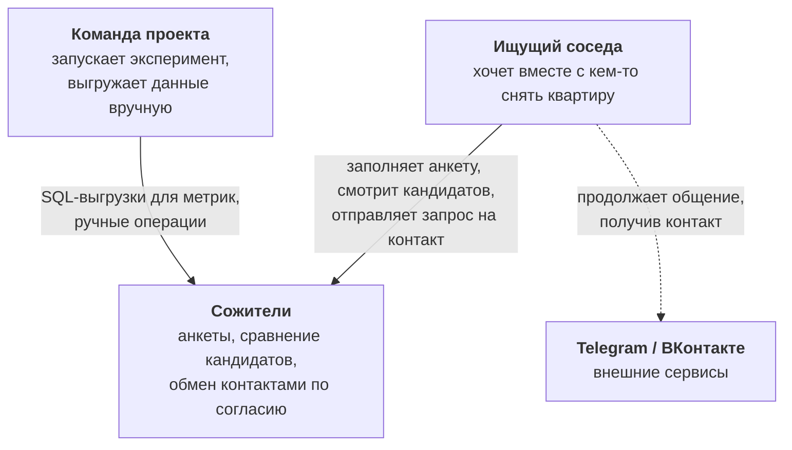
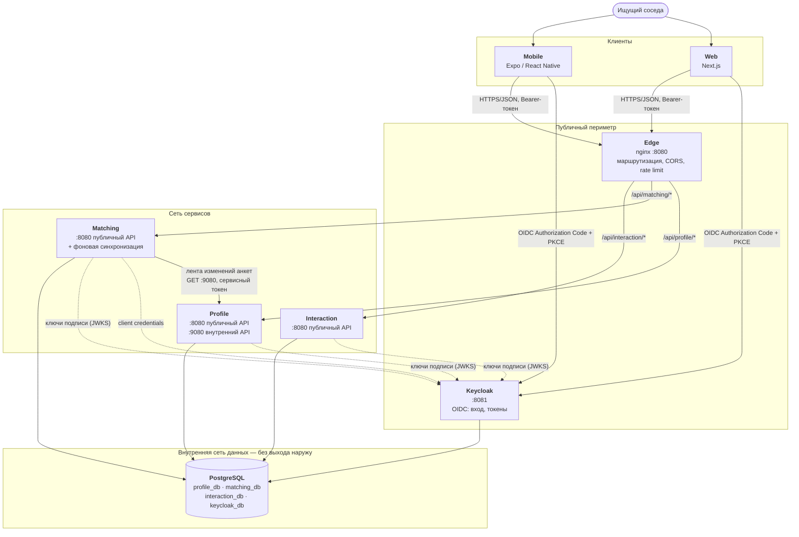
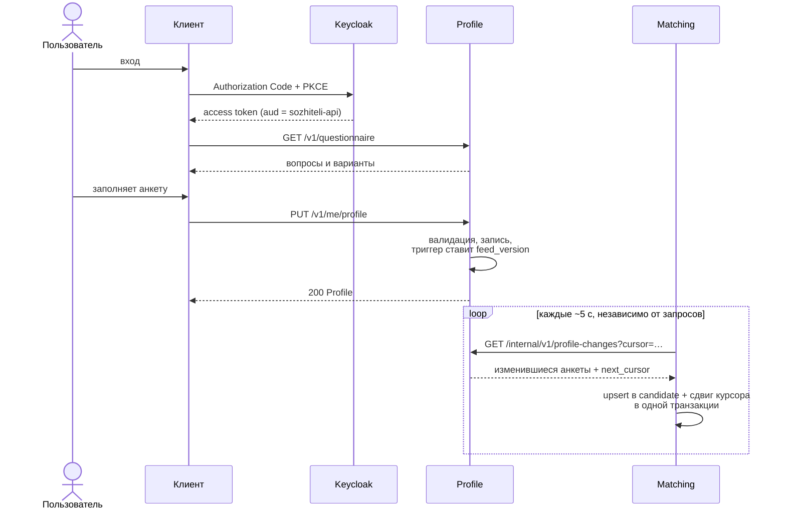
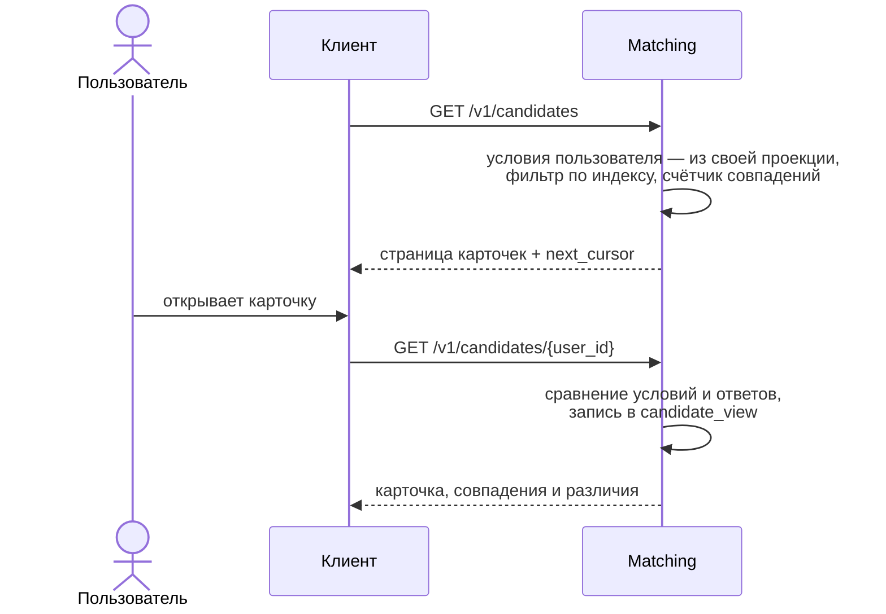
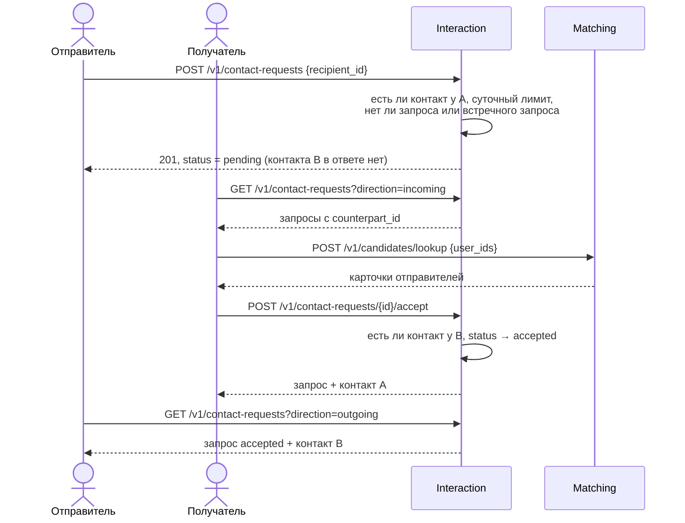

# Архитектура

Architecture Foundation v1. Документ описывает, **что есть в репозитории сейчас**: каждый
компонент, порт и путь ниже существует и проверен (`VERIFICATION.md`). Решения с альтернативами —
в `adr/`.

## 1. Суть решения

Три независимо развёртываемых backend-сервиса на Go, у каждого своя база данных; готовый
OIDC-провайдер; транспортный edge-прокси; два клиентских приложения, работающих через
сгенерированный из контрактов клиент.

| Компонент | Ответственность | Технология |
|---|---|---|
| **Profile** | Анкета пользователя: обязательные условия и ответы о привычках | Go, chi, pgx, sqlc |
| **Matching** | Выдача кандидатов и сравнение анкет на собственной копии данных | Go, chi, pgx, sqlc |
| **Interaction** | Приватный контакт и запросы на обмен контактами | Go, chi, pgx, sqlc |
| **Keycloak** | Регистрация, вход, выпуск токенов | готовое решение, OIDC |
| **Edge** | Единая точка входа: маршрутизация, CORS, ограничение частоты | nginx |
| **PostgreSQL** | Один экземпляр, отдельная база и роли на каждый сервис | PostgreSQL 18 |
| **Web** | Веб-клиент | Next.js, TypeScript |
| **Mobile** | Клиент Android и iOS | React Native, Expo, TypeScript |

Чего **нет** и почему — раздел 8.

## 2. C4: контекст



Система **не интегрирована** с Telegram и ВКонтакте: она только хранит имя пользователя в них и
показывает его второму участнику после взаимного согласия.

## 3. C4: контейнеры



Ключевые свойства схемы:

- **Единственная межсервисная зависимость — Matching → Profile**, и она *фоновая*: при обработке
  пользовательского запроса ни один сервис не вызывает другой. Циклов нет.
- **Interaction не зависит ни от кого.**
- Edge не подключён к сети данных; внутренний порт Profile (9080) через edge не маршрутизируется.
- Каждый сервис проверяет токен сам; edge токены не проверяет.

## 4. Сценарии

### 4.1. Заполнение анкеты и появление в выдаче



Между сохранением анкеты и её появлением в выдаче проходит до одного интервала синхронизации.
Если пользователь открыл выдачу раньше, Matching отвечает `409 profile_not_ready` с `Retry-After`.

### 4.2. Просмотр кандидатов и сравнение



Весь сценарий обслуживает один сервис из одной базы: Profile и Interaction в нём не участвуют.

### 4.3. Запрос на контакт и раскрытие контакта



Карточки и запросы соединяет **клиент** по `user_id`: Interaction не знает анкет, Matching не
знает запросов и контактов.

## 5. Аутентификация и авторизация

Подробно — `SECURITY.md` и ADR-0002, ADR-0012. Коротко:

- Клиенты — публичные OIDC-клиенты, поток Authorization Code + PKCE. Пароль вводится только на
  странице Keycloak.
- Access token — JWT, живёт 5 минут. Каждый сервис проверяет подпись, издателя, срок и аудиторию
  `sozhiteli-api` (пакет `platform/auth`, библиотека go-oidc).
- **Идентификатор пользователя берётся только из токена** (`sub`). В публичных API нет ни одного
  параметра «от чьего имени»: все пользовательские операции адресуются как `/me/…` либо
  проверяют участие вызывающего.
- Межсервисный вызов: Matching получает токен по client credentials с аудиторией
  `sozhiteli-internal` и ролью `internal.profile-changes.read`. Пользовательский токен на
  внутреннем API отклоняется (другая аудитория), сервисный без роли — `403`.

## 6. Модель отказов

Принцип: **отказ одного компонента не должен останавливать сценарии, которым он не нужен.**
Поэтому готовность сервиса зависит только от его собственной базы, а межсервисная связь фоновая.

| Что отказало | Что продолжает работать | Что деградирует | Как система себя ведёт |
|---|---|---|---|
| **Profile** | Выдача и сравнение (Matching на своей копии), запросы на контакт | Создание и изменение анкет; проекция не обновляется | Синхронизация повторяет попытки с растущей паузой до 1 мин и возобновляется сама. Проверено тестом `TestSyncSurvivesProfileOutage` |
| **Matching** | Анкеты, контакты, запросы | Выдача и карточки | Клиент получает `503` от edge; после восстановления Matching догоняет ленту с сохранённого курсора |
| **Interaction** | Анкеты, выдача, сравнение | Контакты и запросы | `503` от edge |
| **Keycloak** | Запросы с уже выданными токенами (ключи подписи закэшированы) — до истечения токена | Новые входы и обновление токенов; синхронизация Matching, когда истечёт сервисный токен | Сервисы стартуют и без Keycloak: ключи запрашиваются при первом запросе |
| **PostgreSQL** | Только `/healthz` | Всё остальное | `/readyz` → `503`, оркестратор выводит экземпляр из ротации; пул переподключается сам |
| **Edge** | Сервисы и синхронизация | Весь внешний доступ | Точка отказа периметра; масштабируется репликами (`SCALING_PLAN.md`) |
| Перегрузка сервиса | Запросы в пределах лимита | Сверх `MAX_IN_FLIGHT` | Немедленный `503` с `Retry-After` вместо очереди до таймаута |
| Медленный запрос к БД | — | Один запрос | Обрыв по `DB_STATEMENT_TIMEOUT` и `REQUEST_TIMEOUT`, ответ `504` |
| Долгая открытая транзакция в PostgreSQL | Все запросы | Лента изменений задерживается (не теряет данные) | Ограничено `idle_in_transaction_session_timeout` (ADR-0004) |

Защитные механизмы, общие для всех сервисов (`backend/platform/httpserver`):

| Механизм | Значение по умолчанию | Переменная |
|---|---|---|
| Таймаут обработки запроса | 5 с | `REQUEST_TIMEOUT` |
| Таймаут SQL-выражения | 3 с | `DB_STATEMENT_TIMEOUT` |
| Предел одновременных запросов | 256 | `MAX_IN_FLIGHT` |
| Размер пула соединений с БД | 10 | `DB_MAX_CONNS` |
| Предел тела запроса | 64 КБ | — |
| Таймаут исходящего вызова (Matching → Profile, Keycloak) | 5 с | — |
| Время на завершение запросов при остановке | 20 с | `SHUTDOWN_TIMEOUT` |

Повторные попытки делает **только** фоновая синхронизация. Сервисы не повторяют запросы друг к
другу в пользовательском пути — таких запросов нет.

## 7. Наблюдаемость

- Логи: JSON в stdout, по одной записи на запрос — метод, путь, статус, размер, длительность,
  `request_id`, `service`. Без тел, заголовков и строки запроса.
- `X-Request-Id`: принимается от клиента или создаётся сервисом, возвращается в заголовке и в
  теле ошибки — по нему находится запись в логе.
- `/healthz` (процесс жив) и `/readyz` (своя база доступна) у каждого сервиса.
- Отставание проекции: `SELECT updated_at FROM sync_state` в `matching_db` и записи
  `profile sync failed` в логе Matching.

Метрик и трассировки в фундаменте **нет** — осознанно; условия появления — `SCALING_PLAN.md`.

## 8. Чего в архитектуре нет

| Не используется | Почему | Когда пересмотреть |
|---|---|---|
| Монолит, модульный монолит | Запрещено заданием | — |
| API Gateway с логикой, BFF | Нет агрегации, которую нельзя сделать на клиенте; edge — только транспорт | Появится экран, которому нужно 3+ последовательных вызова на медленной сети |
| Брокер сообщений (Kafka, NATS) | Один потребитель одной ленты; опрос по HTTP достаточен | Второй потребитель ленты или отставание проекции выше SLO |
| Redis, кэш | Нет измеренной задержки, которую он бы устранил | Профилирование покажет повторяющиеся дорогие чтения |
| Elasticsearch | Фильтр выдачи — равенство и пересечение диапазонов, обслуживается индексом PostgreSQL | Полнотекстовый или гео-поиск |
| Kubernetes, service mesh | Три сервиса и одна база запускаются Compose | Более одной машины и потребность в автоматическом масштабировании |
| CQRS, Event Sourcing | Проекция Matching — это копия состояния, а не журнал событий | — |
| Распределённые транзакции | Ни одна операция не меняет данные двух сервисов | — |
| Сервис аналитики | Измерение — SQL-выгрузки из трёх баз (ADR-0010) | Регулярная аналитика вместо разового эксперимента |
| gRPC | Одна внутренняя операция; HTTP+OpenAPI даёт тот же типизированный клиент | Высокочастотные межсервисные вызовы |

## 9. Структура репозитория

```
contracts/openapi/        OpenAPI-контракты — источник истины для API
backend/
  platform/               общая ТЕХНИЧЕСКАЯ библиотека (без доменных типов)
  services/<service>/
    cmd/<service>/        точка входа: serve | migrate | healthcheck
    internal/api/         публичный API: api.gen.go + server.go + router.go
    internal/store/       sqlc: queries/*.sql → *.go
    internal/config/      конфигурация из окружения
    migrations/           SQL-миграции (goose), встроены в бинарник
    Dockerfile
  tools/                  версии инструментов кодогенерации
packages/api-client/      типизированный TS-клиент, общий для web и mobile
apps/web/                 Next.js
apps/mobile/              Expo
deploy/compose/           локальная среда
tools/                    кроссплатформенные скрипты (Node.js)
tests/load/               сценарии k6
docs/                     документация, ADR
```

Каждый сервис — отдельный Go-модуль со своим `go.mod`; импортировать код другого сервиса
невозможно физически. `backend/go.work` нужен только редактору.

## 10. План эволюции

Этапы и признаки перехода — в `SCALING_PLAN.md`. Что в текущей архитектуре рассчитано на
изменение без переписывания:

| Изменение | Что меняется | Что остаётся |
|---|---|---|
| Новый вопрос анкеты | Новая версия определения в Profile | Контракты, Matching (сравнивает коды обобщённо), клиенты |
| Новый алгоритм сопоставления | Код Matching | Контракты Profile и Interaction, проекция |
| Сегмент 2 (сосед в свою квартиру) | Новые поля и, вероятно, новый тип анкеты в Profile; новые операции Matching | Interaction целиком, аутентификация, механизм ленты |
| Новый клиент (например, Telegram Mini App) | Новый OIDC-клиент в Keycloak | Все сервисы и контракты |
| Рост нагрузки на выдачу | Реплики Matching, позже — читающая реплика БД | Profile, Interaction, контракты |
| Замена опроса на брокер | Доставка ленты | Формат записи ленты, идемпотентное применение в Matching |
| Отдельный сервер БД на сервис | Строка подключения | Код: сервисы уже не делят ни таблиц, ни ролей |
