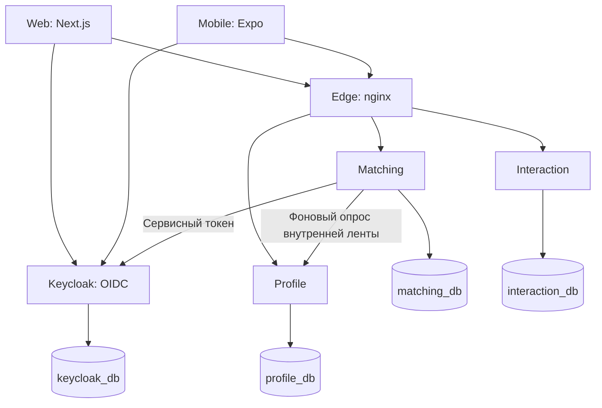

# «Сожители»: полный обзор и технический аудит проекта

Дата: **16 октября 2026 года**. Объект: локальный проект `D:\Сожители`.

## 1. Вывод о состоянии проекта

«Сожители» — учебный сервис поиска человека для совместного поиска и аренды квартиры. Реализован основной web-сценарий: регистрация и вход → заполнение анкеты → поиск кандидатов по обязательным условиям → сравнение бытовых привычек → запрос на обмен контактами → раскрытие контактов после принятия запроса.

Это уже приложение с настоящим backend и базами данных, а не макет интерфейса. В репозитории есть три сервиса на Go, веб-приложение Next.js, мобильное приложение Expo, типизированный API-клиент, контейнеризация, тесты, генерация кода, метрики эксперимента и архитектурная документация.

**Главные ограничения:** конфигурация запуска локальная; публичное размещение ещё нужно подготовить; мобильный сценарий после входа не подтверждён на устройстве; автоматических браузерных E2E-тестов нет; успешный запуск GitHub Actions не подтверждён. Продуктовая гипотеза ещё не доказана.

Для учебного запуска примерно на 10 человек архитектуру можно разместить на одной виртуальной машине с Docker Compose. Разделение на сервисы не требует отдельного сервера для каждого сервиса.

## 2. Методика и границы аудита

Аудит выполнен по исходному коду, OpenAPI-контрактам, SQL-миграциям, Docker-конфигурации, npm-скриптам, CI и документации. Дополнительно запускались проверки, перечисленные в разделе 13.

В отчёте различаются:

- **Реализовано:** механизм присутствует в исходном коде.
- **Проверено сейчас:** команда или HTTP-запрос выполнены в ходе этого аудита.
- **Ранее проверено:** результат записан в `docs/VERIFICATION.md` или `docs/SCALING_PLAN.md`; в этом аудите не воспроизводился.
- **Риск по анализу кода:** есть конкретное основание в реализации, но отдельного воспроизведения проблемы не проводилось.
- **Не реализовано / не проверено:** отсутствие функции либо отсутствие достаточных подтверждений.

Это обзор архитектуры и функций с целевым анализом качества, а не исчерпывающий пентест, сертификация безопасности или проверка всех возможных состояний системы. Исходные интервью из `research/`, рабочие `.env`, пароли, токены и реальные значения контактов в отчёт не включались. Код приложения в ходе аудита не изменялся.

## 3. Назначение продукта и сценарий пользователя

### 3.1. Для кого сделан проект

Целевой сегмент — люди, которые сначала ищут соседа, чтобы затем вместе искать и снимать квартиру. Поиск соседа в уже имеющуюся квартиру — отдельный сценарий, не включённый в текущий MVP.

Проверяемая гипотеза: одинаковый набор сведений и явное сравнение обязательных условий и бытовых привычек помогают решить, стоит ли продолжать общение с кандидатом.

В исследовании описаны пять интервью, но к целевому сегменту относятся только два. Решение респондентам не показывали. Поэтому наличие проблем подтверждено качественными свидетельствами, а полезность именно этого решения остаётся предметом эксперимента. По этим интервью нельзя вычислять проценты распространённости проблем.

### 3.2. Полный пользовательский путь

1. Открыть главную страницу.
2. Перейти на страницу входа или регистрации Keycloak.
3. Зарегистрироваться по email и паролю либо войти в существующий аккаунт.
4. Вернуться в приложение через OIDC callback.
5. Заполнить личные сведения, город, бюджет, сроки и восемь ответов о быте.
6. Указать приватный контакт Telegram или ВКонтакте.
7. Открыть выдачу кандидатов, прошедших обязательные условия.
8. Посмотреть карточку, сравнение условий, совпадения и различия привычек.
9. Отправить запрос на обмен контактами.
10. Получатель открывает входящие и принимает или отклоняет запрос.
11. После принятия оба участника получают актуальный контакт друг друга.
12. Дальнейшее общение проходит во внешнем мессенджере.

Telegram и ВКонтакте не подключены через API: система хранит идентификаторы пользователей и формирует ссылки. Ботов, импорта переписок и проверки владения страницей нет.

## 4. Технологический стек

Версии ниже прочитаны из файлов проекта; это не рекомендация использовать самые новые версии.

| Слой | Технологии и версии в проекте |
|---|---|
| Организация | Monorepo, npm workspaces, отдельные Go-модули, `backend/go.work` |
| Web | Next.js 16.4.0, React 19.2.3, TypeScript 6.0.3 |
| Mobile | Expo SDK 57, React Native 0.86.3, Expo Router, react-native-web |
| Backend | Go 1.27, chi, pgx, sqlc |
| Идентификация | Keycloak 26.8.1, OIDC, Authorization Code + PKCE |
| База данных | PostgreSQL 18.6 |
| Вход в API | nginx 1.30.5 |
| Контракты | OpenAPI 3.0.3, Redocly, oapi-codegen, openapi-typescript |
| Клиент API | openapi-fetch 0.17.0 |
| Миграции | goose; SQL встроен в исполняемые файлы Go |
| Проверки | Go tests, Vitest, ESLint, Prettier, TypeScript, golangci-lint, expo-doctor, k6 |
| Развёртывание | Docker, Docker Compose, GitHub Actions для проверок |
| Среда аудита | Node.js 24.14.0, npm 11.9.0, Go 1.27.0, Windows amd64 |

Go-образы используют `golang:1.27.2-alpine`, Node-образ web — `node:24.14.0-alpine`. Разница patch-версии локального Go и образов отмечается как особенность среды, сама по себе не доказывает ошибку.

## 5. Структура репозитория

```text
Сожители/
├── apps/
│   ├── web/                      Веб-приложение Next.js
│   │   ├── src/app/              Страницы и общий layout
│   │   ├── src/components/       Формы, карточки, выбор города, состояния
│   │   ├── src/lib/              Вход, конфигурация, API, справочники
│   │   ├── src/proxy.ts          Content-Security-Policy с nonce
│   │   └── Dockerfile            Автономная production-сборка Next.js
│   └── mobile/                   Expo / React Native
│       ├── app/(tabs)/           Кандидаты, запросы, анкета, контакт
│       ├── app/candidate/        Карточка кандидата
│       ├── app/auth/             Маршрут возврата после входа
│       └── src/                  Вход, API, хранилище токена, UI
├── backend/
│   ├── platform/                 Общие технические пакеты
│   ├── services/
│   │   ├── profile/              Анкеты и справочники
│   │   ├── matching/             Выдача, сравнение и проекция анкет
│   │   └── interaction/          Контакты и запросы на обмен
│   ├── tools/                    Закреплённые Go-инструменты генерации
│   └── go.work                   Рабочее пространство Go
├── contracts/
│   ├── openapi/                  Три публичных и один внутренний контракт
│   └── redocly.yaml              Правила проверки контрактов
├── packages/api-client/          Общий клиент API для web и mobile
├── deploy/compose/               PostgreSQL, Keycloak, nginx, сервисы и web
├── tools/                        Запуск проверок, генерация, demo, load, metrics
├── tests/load/                   Нагрузочные сценарии k6
├── docs/                         Правила, API, архитектура, аудит и состояние
│   └── adr/                      13 архитектурных решений
├── .github/workflows/ci.yml      Конвейер проверок
├── research/                     Локальные исходные исследования; исключены из Git
├── package.json                  Команды и npm workspaces
└── README.md                     Описание и быстрый запуск
```

`node_modules`, `.next`, `.expo`, `dist`, `*.tsbuildinfo` — зависимости или результаты сборки. Они не являются самостоятельными функциями продукта. Сгенерированные API-типы и SQL-обёртки, напротив, входят в архитектуру и должны соответствовать своим источникам.

### 5.1. Внутренняя структура backend-сервиса

```text
services/<service>/
├── cmd/<service>/main.go         Конфигурация, сборка зависимостей, запуск
├── internal/config/              Переменные окружения
├── internal/api/
│   ├── api.gen.go                Сгенерированные типы и серверный интерфейс
│   ├── router.go                 Маршрутизация и middleware
│   ├── server.go                 Реализация операций
│   ├── convert.go                Преобразование БД → API
│   └── *_test.go                 Контрактные и интеграционные проверки
├── internal/store/
│   ├── queries/*.sql             Источники SQL-запросов
│   └── *.go                      Код, полученный через sqlc
├── internal/<domain>/            Чистые бизнес-правила
├── migrations/                   Версионируемые изменения схемы
├── go.mod / go.sum               Зависимости сервиса
└── Dockerfile                    Отдельный образ
```

Направление зависимостей: `cmd → api → domain/store`. В общей библиотеке `platform` находятся технические механизмы, а не правила подбора или раскрытия контактов.

## 6. Архитектура и взаимодействия

### 6.1. Общая схема



Все четыре базы в локальной конфигурации обслуживает **один экземпляр PostgreSQL**. Это разделение баз и прав доступа, а не четыре независимых сервера БД.

### 6.2. Ответственность компонентов

| Компонент | Что делает | Чего не делает |
|---|---|---|
| Profile | Хранит собственную анкету пользователя, города, определение опросника; отдаёт изменения для Matching | Не хранит приватные контакты и не строит выдачу |
| Matching | Хранит копию анкет, фильтрует кандидатов, сравнивает условия и привычки, пишет факты просмотров | Не меняет исходные анкеты, не знает контактов и решений по запросам |
| Interaction | Хранит контакт, создаёт и обрабатывает запросы, контролирует раскрытие | Не проверяет профиль через Profile и не строит карточки кандидатов |
| Keycloak | Регистрация, вход, учётные записи, токены и сессии | Не хранит продуктовую анкету |
| Edge | Маршрутизация, CORS, лимит частоты, транспортные ошибки | Не агрегирует бизнес-ответы и не проверяет JWT вместо сервисов |
| API-клиент | Типизированные вызовы, Bearer-токен, `X-Request-Id`, общие преобразования представления | Не заменяет серверную авторизацию |
| Web / Mobile | Показывают интерфейс и соединяют ответы сервисов по идентификаторам | Не владеют серверными данными |

Во время выполнения пользовательской операции ни один из трёх предметных сервисов не вызывает другой предметный сервис. Единственное предметное межсервисное взаимодействие — фоновая синхронизация Matching из Profile. При этом сервисы зависят от инфраструктуры идентификации для получения/обновления ключей и токенов.

### 6.3. Синхронизация анкет

1. Пользователь сохраняет анкету в Profile.
2. Триггер БД записывает `updated_at` и `feed_version`, основанный на идентификаторе транзакции PostgreSQL.
3. При удалении анкеты триггер создаёт отметку в `profile_deletion`.
4. Matching примерно каждые 5 секунд читает `/internal/v1/profile-changes`; обычный размер страницы — 200 изменений.
5. Profile отдаёт только версии ниже горизонта незавершённых транзакций, чтобы не пропустить поздно зафиксированную запись.
6. Matching применяет версии идемпотентно и сдвигает курсор в одной транзакции с обновлением проекции.
7. Сдвиг курсора через compare-and-set защищает от одновременного применения страницы несколькими репликами.
8. При сбое курсор не сдвигается; повторные попытки используют растущую паузу до минуты и случайную добавку к задержке.

Это **согласованность с задержкой**. Сохранённая анкета не обязана немедленно появляться в Matching. Пока собственной анкеты нет в проекции, операции Matching возвращают `409 profile_not_ready` с `Retry-After`.

Лента содержит текущие состояния и отметки удаления, а не неизменяемую историю каждого редактирования. Брокера сообщений, Redis и event sourcing нет. Долгая транзакция PostgreSQL может задерживать горизонт ленты.

### 6.4. Поведение при отказах

| Отказ | Ожидаемое поведение по реализации |
|---|---|
| Profile | Нельзя менять анкету; Matching продолжает работать на уже полученной проекции |
| Matching | Анкета и запросы на контакт доступны через свои API; карточки и выдача недоступны |
| Interaction | Выдача и анкета работают; обмен контактами недоступен |
| Keycloak | Новые входы и обновление токенов недоступны; ранее выданные токены могут работать до истечения срока при наличии закэшированных ключей |
| Общий PostgreSQL | Недоступны все операции, требующие БД; readiness сервисов не проходит |
| Edge или единственная машина | Внешние пользовательские сценарии недоступны |

Частичная независимость API не гарантирует полную независимость интерфейса: списки запросов дополнительно запрашивают карточки Matching, а подписи городов и вопросов загружаются из Profile.

## 7. Все реализованные продуктовые функции

### 7.1. Учётная запись и вход

- Вход и регистрация через Keycloak; пароль не обрабатывается кодом продукта.
- Регистрация по email и паролю, без имени и фамилии в форме Keycloak.
- Русские тексты и собственная тема страниц входа.
- Политика паролей: минимум восемь символов, пароль не должен совпадать с email.
- Authorization Code + PKCE для публичных web- и mobile-клиентов.
- Callback-маршруты после входа и защита внутренних разделов интерфейса.
- Выход и управление состоянием сессии.
- Web: токены в `sessionStorage` вкладки, автоматическое обновление через oidc-client-ts.
- Mobile: access token в памяти, refresh token в SecureStore; в браузерном режиме Expo — только в памяти.

Подтверждение email и доставка писем для восстановления пароля зависят от настройки Keycloak/SMTP в целевой среде. Полноценный почтовый сценарий в этом аудите не проверялся.

### 7.2. Собственная анкета

| Поле | Реализованное поведение |
|---|---|
| Имя | 2–40 символов после удаления пробелов по краям |
| Год рождения | Сервер проверяет возраст по разности годов: 18–100 лет; схема также задаёт пределы 1930–2100 |
| Пол | `female` / `male` |
| Род занятий | 2–80 символов после нормализации |
| Город | Выбор из справочника; существование проверяется сервером |
| Районы | Свободный текст до 200 символов, может быть пустым |
| Бюджет | Минимум и максимум, целые рубли от 0 до 1 000 000, максимум не ниже минимума |
| Смысл бюджета | Месячная доля аренды на человека, без коммунальных платежей |
| Заселение | Диапазон дат; конец не раньше начала и не в прошлом |
| Пол соседа | Любой либо только такой же, как у пользователя |
| Бытовые привычки | Обязательные ответы на восемь вопросов актуальной версии |
| Статус поиска | `searching` / `paused` |

Сохранение полностью создаёт или заменяет анкету (`PUT`); частично заполненных серверных анкет нет. Проверки схемы и бизнес-правил разделены. Бизнес-ошибки возвращаются сразу по нескольким полям.

В свободном тексте отклоняются очевидные контакты: `@`, ссылки и характерные домены, длинные последовательности цифр. Это эвристический барьер, который можно обойти, а не гарантия отсутствия контактов.

### 7.3. Справочники и опросник

Города: 1117 записей, 85 регионов по документации и тестам. Данные встроены миграцией из справочника HFLabs, с указанием CC BY-SA 4.0 и года данных 2021. Поиск по загруженному списку выполняет клиент; регионы помогают различать города-тёзки. Это фиксированный набор данных проекта, а не автоматически обновляемый административный справочник.

Опросник хранится в коде Profile как версионируемые данные. Текущая версия — 1.

| Код | Вопрос | Варианты |
|---|---|---|
| `smoking` | Курение | Не курю; курю вне квартиры; курю дома/на балконе |
| `pets` | Животные | Нет и не планирую; есть или планирую |
| `dishes` | Посуда | Сразу; в течение дня; когда накопится |
| `cleaning` | Общая уборка | По графику; по мере загрязнения |
| `guests` | Гости | Не привожу; предупреждаю; могу без предупреждения |
| `sleep` | Время сна | До 23:00; 23:00–01:00; после 01:00 |
| `shared_purchases` | Бытовые расходники | Общие покупки пополам; каждый себе |
| `socializing` | Общение | Дружба; доброжелательное соседство; минимум общения |

Неизвестные вопросы, неизвестные варианты, пропуски ответов и неподдерживаемая версия отклоняются сервером.

### 7.4. Подбор и сравнение кандидатов

Выдача отбирает:

- Только анкеты со статусом `searching`.
- Других пользователей, исключая самого зрителя.
- Тот же город.
- Пересекающийся диапазон бюджета, включая совпадение границ.
- Пересекающиеся даты заселения, включая совпадение границ.
- Взаимно соблюдённые предпочтения по полу соседа.

Сортировка — по времени обновления анкеты, затем по UUID, по убыванию. Размер страницы по умолчанию — 20; продолжение через непрозрачный курсор. Район не используется как автоматический фильтр.

Карточки показывают сведения кандидата, условия, статус поиска и число совпавших ответов. Подробная карточка отдельно сравнивает четыре обязательных условия и ответы о быте. Возможные результаты ответа: `match`, `difference`, `not_comparable`.

Совпадение — равенство кодов вариантов. Взвешивания вопросов, машинного обучения, предсказания успешного совместного проживания и сортировки по числу совпадений нет.

Открытие подробной карточки записывает событие в `candidate_view`. Если запись просмотра не удалась, операция карточки тоже завершается ошибкой. Просмотры списка и batch lookup таких событий не создают.

`lookupCandidates` получает карточки по списку идентификаторов, восстанавливает порядок запроса, исключает собственный и неизвестные ID. Этот механизм нужен для подписей собеседников в запросах на контакт.

**Пауза скрывает из общей выдачи, но не делает анкету приватной.** Карточка по известному ID и lookup продолжают возвращать анкету на паузе. Это явно реализовано и покрыто тестом `TestGetCandidateShowsPausedProfiles`.

### 7.5. Приватный контакт

- Просмотр собственного контакта.
- Создание или замена контакта.
- Поддерживаются Telegram и ВКонтакте.
- Telegram: имя без `@`, 5–32 символа, первый символ — латинская буква.
- ВКонтакте: короткое имя/ID, 2–32 символа из букв, цифр, `_` и `.`.
- Формат проверяется, но принадлежность и существование страницы не подтверждаются.
- Контакт отсутствует в Profile и Matching.
- Удаления собственного контакта через API нет.

### 7.6. Запросы на обмен контактами

| Действие / правило | Поведение |
|---|---|
| Отправить запрос | Только при наличии своего контакта; начальный статус `pending` |
| Запросить самого себя | `422` |
| Повторить запрос той же паре | `409 request_exists`, включая ранее отклонённый запрос |
| Создать встречный запрос | `409 reverse_request_exists`; предлагается ответить на существующий |
| Суточный лимит | По умолчанию 20 новых запросов за скользящие 24 часа; при превышении `429` |
| Принять | Только получатель и только `pending`; нужен свой контакт |
| Отклонить | Только получатель и только `pending` |
| Повторно ответить | `409 already_responded` для получателя |
| Ответить на чужой запрос | `404`, чтобы не раскрывать ресурс |
| Список | Входящие / исходящие, фильтр по собеседнику, курсорная пагинация |
| Раскрытие | Только после `accepted` и только двум участникам |

Создание сериализуется по неупорядоченной паре пользователей через advisory lock PostgreSQL. Это защищает от одновременных встречных запросов. Ограничение уникальности БД отдельно запрещает повтор одной направленной пары.

После принятия контакт читается из текущей таблицы `contact`, а не из снимка на момент принятия. Замена своего контакта меняет то, что увидят участники уже принятых запросов. Отзыва согласия и отмены запроса в MVP нет.

Interaction намеренно не проверяет существование профиля получателя и совместимость условий: он работает только со своими данными. Прямой API-вызов может создать запрос на произвольный UUID; общий сценарий UI обычно берёт UUID из карточки кандидата.

### 7.7. Web-интерфейс

| Маршрут | Содержание |
|---|---|
| `/` | Главная, описание сервиса, вход и начало сценария |
| `/auth/callback` | Возврат из OIDC-входа |
| `/profile` | Создание и редактирование анкеты, города, привычки, статус поиска |
| `/contact` | Собственный контакт и ошибки формата |
| `/candidates` | Выдача, свои условия, карточки, загрузка следующей страницы |
| `/candidates/[userId]` | Условия и привычки кандидата, состояние обмена, отправка запроса |
| `/requests` | Входящие/исходящие, статусы, принятие/отклонение, ссылки на открытые контакты |

В шапке есть навигация и счётчик ожидающих входящих запросов. Он обновляется при переходах между страницами и после ответа, а не через WebSocket или периодический опрос. Есть загрузочные, пустые и ошибочные состояния, полевые ошибки формы, адаптация под узкий экран, аватары с инициалами.

Документация предыдущей сборки сообщает о восьми маршрутах Next.js; приведённая выше таблица перечисляет семь пользовательских шаблонов страниц и не выдаёт служебный маршрут сборки за отдельную функцию.

### 7.8. Мобильное приложение

Реализованы приветственный экран, OIDC-вход, четыре вкладки «Кандидаты», «Запросы», «Анкета», «Контакт», отдельная карточка кандидата и маршрут callback. Используется тот же backend и общий API-клиент. Есть общие UI-компоненты, светлая и тёмная тема.

По предыдущему протоколу прошли проверка типов, линтер, expo-doctor, сборка Android JS-бандла и web-режим до входа. **Проверка приложения на реальном Android/iOS или эмуляторе, входа и всех экранов после входа остаётся незавершённой.** Сборка JS-бандла не равна проверке устанавливаемого приложения. Для собственного callback нужен development build; Expo Go не считается подтверждённым путём запуска.

## 8. Полный каталог API

**13 публичных операций и 1 внутренняя, всего 14.** Все помечены `implemented`; обработчики присутствуют в коде. Формулировка документации «все 13 операций всех контрактов» неточна: 13 — количество публичных операций.

Публичные адреса ниже приводятся с префиксом edge. В самом контракте путь начинается с `/v1/...`.

| № | Сервис | Метод и путь через edge | Operation ID | Назначение |
|---|---|---|---|---|
| 1 | Profile | `GET /api/profile/v1/questionnaire` | `getQuestionnaire` | Текущие вопросы и варианты |
| 2 | Profile | `GET /api/profile/v1/cities` | `listCities` | Справочник городов |
| 3 | Profile | `GET /api/profile/v1/me/profile` | `getMyProfile` | Своя анкета |
| 4 | Profile | `PUT /api/profile/v1/me/profile` | `putMyProfile` | Создать/заменить свою анкету |
| 5 | Matching | `GET /api/matching/v1/candidates` | `listCandidates` | Страница подходящих кандидатов |
| 6 | Matching | `GET /api/matching/v1/candidates/{user_id}` | `getCandidate` | Детальная карточка, сравнение, запись просмотра |
| 7 | Matching | `POST /api/matching/v1/candidates/lookup` | `lookupCandidates` | Карточки по списку ID |
| 8 | Interaction | `GET /api/interaction/v1/me/contact` | `getMyContact` | Свой контакт |
| 9 | Interaction | `PUT /api/interaction/v1/me/contact` | `putMyContact` | Сохранить свой контакт |
| 10 | Interaction | `GET /api/interaction/v1/contact-requests` | `listContactRequests` | Входящие/исходящие |
| 11 | Interaction | `POST /api/interaction/v1/contact-requests` | `createContactRequest` | Отправить запрос |
| 12 | Interaction | `POST /api/interaction/v1/contact-requests/{request_id}/accept` | `acceptContactRequest` | Принять запрос |
| 13 | Interaction | `POST /api/interaction/v1/contact-requests/{request_id}/decline` | `declineContactRequest` | Отклонить запрос |
| 14 | Profile internal | `GET :9080/internal/v1/profile-changes` | `listProfileChanges` | Страница изменений анкет; через edge недоступна |

### 8.1. Общий контракт

- JSON, UTF-8, поля в `snake_case`, UUID строками.
- Время в RFC 3339 UTC, календарные даты в `YYYY-MM-DD`.
- Bearer-аутентификация обязательна для всех предметных операций, включая справочники.
- Пользователь определяется через `sub` проверенного токена; `/me` не принимает чужой ID владельца.
- Ошибки — `application/problem+json`, стабильное поле `code`, при необходимости `errors[]` по полям.
- `400` — нарушение схемы; `422` — бизнес-валидация; `409` — конфликт состояния; `429` — лимит.
- Неожиданные серверные ошибки не раскрывают SQL и внутренние подробности клиенту.
- `X-Request-Id` связывает запрос клиента, ответ и логи сервисов.
- Пагинация по курсорам; полного количества записей в ответе нет.
- Публичные токены имеют audience `sozhiteli-api`; внутренняя лента требует `sozhiteli-internal` и роль `internal.profile-changes.read`.

Служебные `/healthz` и `/readyz` стоят отдельно от продуктовых OpenAPI-операций и не включены в число 14.

## 9. Данные и схема хранения

| База | Таблица / данные | Владелец и смысл |
|---|---|---|
| `profile_db` | `profile` | Исходная анкета, условия, JSONB привычек, статус, даты, версия ленты |
| `profile_db` | `city` | Фиксированный справочник городов и регионов |
| `profile_db` | `profile_deletion` | Отметки удалённых профилей для синхронизации |
| `matching_db` | `candidate` | Читаемая копия анкеты, исходная версия и время синхронизации |
| `matching_db` | `sync_state` | Курсор чтения ленты Profile |
| `matching_db` | `candidate_view` | Кто открыл чью карточку, время и число совпадений |
| `interaction_db` | `contact` | Единственное продуктовое хранилище приватных контактов |
| `interaction_db` | `contact_request` | Отправитель, получатель, статус, время создания и ответа |
| `keycloak_db` | Схема Keycloak | Email, хэши паролей, учётные записи, сессии |

Дополнительно goose ведёт служебное состояние миграций. Бизнес-таблицы разделены по владельцам; внешние ключи между базами не используются.

У каждого предметного сервиса есть отдельные роли миграций и приложения. Рабочая роль должна работать со строками своей базы, без изменения схемы и подключения к чужим базам. Инициализация находится в `deploy/compose/postgres/init/10-databases.sh`.

Ключевые индексы: лента Profile по `(feed_version, user_id)`; частичный индекс выдачи Matching по городу и свежести активных анкет; индексы входящих и исходящих Interaction по участнику, времени и ID. Курсорная пагинация не использует большие OFFSET.

Миграции: Profile — исходная схема и наполнение городов; Matching — своя исходная схема; Interaction — своя исходная схема. Применяются отдельными одноразовыми контейнерами под ролью миграций до старта сервисов.

Удаление пользователя выполняется оператором: запросы и контакт в Interaction → анкета в Profile → ожидание удаления проекции → события просмотров в Matching → аккаунт в Keycloak. Единой транзакции между этими шагами нет. Автоматической политики хранения событий и отзыва раскрытого контакта нет.

## 10. Безопасность: что реализовано и где границы

### 10.1. Реализованные механизмы

| Механизм | Реализация |
|---|---|
| Проверка JWT | go-oidc: подпись, issuer, audience, срок; ключи JWKS с кэшированием |
| Разделение пользовательского и сервисного доступа | Разные audience, обязательная роль внутренней ленты, отдельный порт |
| Владение ресурсами | ID из контекста авторизации; ответ на запрос только его получателем |
| Приватность контактов | Только участникам принятого запроса; SQL JOIN контакта только при `accepted` |
| SQL-инъекции | Параметризованные SQL-запросы через sqlc/pgx |
| Проверка тела | OpenAPI-валидация до бизнес-обработчика, лимит 64 КиБ |
| Перегрузка | По умолчанию 256 одновременных API-запросов на listener; сверх лимита `503` |
| Таймауты | Запрос 5 с, SQL 3 с, завершение 20 с; HTTP-вызовы ограничены |
| Частота на edge | 20 запросов/с на IP, burst 40 |
| CORS | Только настроенные origin web и локального Expo web |
| Web CSP | Nonce на запрос, ограничения script/style/connect/frame; dev-режим имеет послабления |
| Дополнительные заголовки web | Защита от встраивания, MIME sniffing, политика referrer, ограничение возможностей браузера |
| Изоляция контейнеров | Backend distroless/nonroot, read-only, сброс capabilities |
| Изоляция БД | Внутренняя сеть `data`, PostgreSQL без опубликованного порта |
| Секреты | Рабочие `.env` исключены из Git; публичные переменные клиентских сборок секретами не считаются |
| Логи сервисов | Метод, путь без query string, код, длительность, request ID; без тел и значений контактов |

CORS ограничивает чтение ответов браузером и не заменяет аутентификацию API. CSP снижает риск XSS, но не превращает токены в недоступные JavaScript: `sessionStorage` по-прежнему доступен коду страницы.

### 10.2. Признанные ограничения

- Контакты хранятся в БД без прикладного шифрования.
- Нет отдельного журнала доступа к контактам.
- Нет блокировок пользователей, жалоб, модерации и верификации личности.
- Пауза не запрещает просмотр анкеты по ID.
- Возраст вычисляется по году, поэтому точное совершеннолетие в день рождения не устанавливается.
- Контактный фильтр свободного текста эвристический.
- Запрос на контакт не доказывает существование аккаунта получателя.
- При изменении контакта уже принятые связи видят новое значение.
- Экспорт метрик содержит связи идентификаторов людей и требует ограниченного доступа, даже без имён.

Наличие этих ограничений не означает, что обнаружена утечка данных. Это свойства текущей модели и вопросы для целевого сценария эксплуатации.

## 11. Локальный запуск и развёртывание

### 11.1. Что поднимает Compose

Один PostgreSQL, Keycloak, три контейнера миграций, три Go-сервиса, nginx и web при включённом профиле `app`. После завершения миграций остаются семь длительно работающих контейнеров с web.

Сети: `data` — внутренняя для БД; `backend` — для сервисов и edge. Web обращается к API из браузера и не нуждается в серверном доступе к `backend`.

| Адрес на компьютере | Назначение |
|---|---|
| `http://localhost:3000` | Web |
| `http://localhost:8080/api/...` | Публичные API через nginx |
| `http://localhost:8080/healthz` | Проверка edge |
| `http://localhost:8081` | Keycloak |
| `profile:9080` в контейнерной сети | Внутренняя лента; наружу не опубликована |

Публичные в смысле архитектуры порты текущего Compose привязаны к `127.0.0.1`: приложение не становится доступным из интернета после простой загрузки файлов на VPS.

### 11.2. Команды

| Команда | Назначение |
|---|---|
| `npm install` | Установить npm-зависимости |
| `npm run setup` | Создать локальные `.env` из шаблонов |
| `npm run app:up` | Собрать и поднять весь стек с web, дождаться healthchecks |
| `npm run infra:up` | Поднять backend и инфраструктуру без web |
| `npm run web:dev` | Web в режиме разработки |
| `npm run infra:down` | Остановить стек, сохранив данные |
| `npm run infra:reset` | Остановить стек и удалить тома с данными; разрушительная команда |
| `npm run infra:logs` | Читать логи |
| `npm run infra:smoke` | Сквозная проверка локальной среды, в том числе авторизации и изоляции |
| `npm run mobile:start` | Expo dev server |
| `npm run web -w @sozhiteli/mobile` | Expo web, порт 8082 |

Compose использует `restart: unless-stopped`, проверки готовности и ожидание миграций. Наличие healthcheck само по себе не означает автоматический перезапуск зависшего, но ещё живого процесса: полноценного оркестратора здесь нет.

### 11.3. Что нужно до публичного запуска

1. Production-конфигурация домена, HTTPS и внешних адресов API/OIDC; согласованные redirect URI и CORS.
2. Пересборка web с нужными `NEXT_PUBLIC_*`: эти адреса попадают в клиентский код при сборке.
3. Keycloak `start` вместо `start-dev`, корректные proxy/hostname-настройки, собственный realm без dev-клиента и тестовых пользователей.
4. Собственные секреты вместо `dev-only-*`, закрытый административный доступ.
5. Резервные копии PostgreSQL и проверенная процедура восстановления.
6. Проверка реального сценария двумя пользователями уже по публичным адресам.
7. По требованиям проекта — настройка почты/подтверждения email и оформление обработки персональных данных владельцем продукта.
8. Повторный замер ресурсов и базовой нагрузки на выбранном VPS.

Для демонстрации на 10 человек стартовая оценка — 2 vCPU, 4 ГБ RAM, SSD 40–50 ГБ. Это инженерная оценка, а не подтверждённый тест такой машины. Сборки лучше выполнять отдельно от сервера приложения. Все сервисы могут остаться на одной машине; Kubernetes для этого масштаба не требуется.

## 12. Аналитика, демо и нагрузка

### 12.1. Метрики эксперимента

`tools/metrics.mjs` читает данные нескольких баз и объединяет их в операторском скрипте. Это не межбазовый JOIN в пользовательском запросе и не отдельный сервис аналитики.

| Метрика | Что измеряет |
|---|---|
| M1 | Доля пар «зритель — кандидат» с просмотром карточки, для которых отправлен запрос |
| M2 | `accepted / (accepted + declined)`; ожидающие ответы отдельно |
| M3 | Средняя доля совпадений для пар с запросом и без запроса |
| M4 | Доля созданных анкет среди зарегистрированных пользователей |

Для M3 используется последний просмотр до запроса, если он есть; случаи без такого просмотра учитываются с оговоркой. По запросу создаётся CSV `pairs.csv`. Имена и контакты не экспортируются, но идентификаторы и связи всё равно чувствительны.

Пороги успеха M1, M2, M4 и качественного интервью K1 не утверждены. M3 показывает связь, а не причинность. При десяти участниках данные пригодны прежде всего для качественной обратной связи и проверки сценария, а не для уверенных статистических выводов.

### 12.2. Демо-данные

`demo:seed` / `demo:clean` создают и очищают 60 синтетических анкет в шести городах. У демо-профилей нет учётных записей и контактов; они не смогут принять запрос. Метрики исключают их по зарезервированному префиксу ID. Это инструмент локальной демонстрации, не способ наполнения публичной базы реальными людьми.

`load:seed` / `load:clean` подготавливают отдельный набор из 10 000 анкет для нагрузки. Команды очистки не следует переносить в эксплуатационный процесс без проверки их назначения.

### 12.3. Что измерялось ранее

Источник: `docs/SCALING_PLAN.md`, прогон 14 октября 2026 года на ноутбуке разработчика с Docker Desktop, не на целевом VPS. 10 000 анкет, три минуты, 50 запросов/с суммарно, Matching напрямую, без edge.

| Операция | p95 | p99 | Ошибки |
|---|---|---|---|
| Выдача кандидатов | 6,9 мс | 9,2 мс | 0 |
| Карточка с записью просмотра | 66,8 мс | 162 мс | 0 |
| Карточки по списку ID | 7,9 мс | 12 мс | 0 |

Ранее также описаны доставка новых анкет и удалений в Matching и работа двух реплик Matching. В ходе этого аудита нагрузочные сценарии заново не запускались.

Эти цифры не измеряют время входа, полный браузерный путь, массовую запись контактных запросов, долгую работу, предел пропускной способности и работу конкретного арендованного сервера.

Предварительные SLO проекта: доступность 99,5% за 30 дней; чтение p95 ≤ 150 мс / p99 ≤ 400 мс; запись p95 ≤ 250 мс / p99 ≤ 600 мс; свежесть проекции 95% ≤ 15 с / 99% ≤ 60 с. Это цели из документации, а не достигнутая месячная статистика.

## 13. Проверки и подтверждения

### 13.1. Проверки, выполненные в этом аудите

Окончательные результаты запусков приведены в приложении «Протокол текущего аудита» в конце файла. Команды запускались без изменения бизнес-кода и без сброса рабочей базы. Backend-интеграционные тесты используют отдельный временный PostgreSQL.

### 13.2. Какие тесты существуют

| Область | Содержание |
|---|---|
| Platform | JWT и роли, request ID, ошибки, конфигурация, health/readiness, перегрузка, отмена по timeout, корректная остановка |
| Profile | Валидация и нормализация, версия анкеты, справочник городов, свои данные, создание/замена, ошибки полей, миграции |
| Внутренняя лента | Порядок и страницы, изменения/удаления, медленные транзакции, роль и audience, неверные параметры |
| Matching | Фильтры, предпочтения пола, курсоры, собственная анкета, сравнение, запись просмотров, карточки на паузе, lookup |
| Проекция Matching | Применение/удаление, курсор, идемпотентность, устаревшие версии, отказ Profile, нарушение контракта, остановка |
| Interaction | Форматы контакта, правила запросов, последовательный суточный лимит, встречные конкурентные запросы, раскрытие, чужие запросы, страницы |
| API-клиент | URL/заголовки/ошибки и общие функции представления; 16 тестов в двух файлах |
| Среда | Скрипт smoke: маршрутизация, вход, изоляция БД, синхронизация, ошибки |
| Нагрузка | k6 smoke, baseline и продуктовые чтения |

Тесты `TestImplementationStatusMatchesBehaviour` сравнивают пометки контрактов и поведение сервисов. Поиск по исходникам не обнаружил вызовов `problem.NotImplemented()` в продуктовых обработчиках; сама заготовка ошибки остаётся в общей библиотеке.

### 13.3. CI

В `.github/workflows/ci.yml` определены четыре группы:

1. Контракты: `npm ci`, lint OpenAPI, проверка воспроизводимости генерации.
2. Backend: формат, зависимости, сборка, vet, линтер, интеграционные тесты; Linux CI включает детектор гонок.
3. Образы: `app:up`, сборка всех образов включая web, smoke и очистка временной среды CI.
4. Клиенты: установка зависимостей, формат, линтер, типы, Vitest, web build, expo-doctor и Android JS export.

Конвейер настроен на push в `main` и pull request. Автоматической публикации приложения на VPS, контейнерного registry, миграций production и отката релиза в нём нет. По `VERIFICATION.md`, сам GitHub-конвейер ещё не запускался; текущий аудит удалённую историю GitHub не проверял.

`npm test` не является браузерным тестом web/mobile: фактически тестовый script есть у API-клиента. Интерфейс проверялся вручную ранее. Полного автоматического сценария регистрации, двух пользователей, отправки и принятия запроса нет.

## 14. Найденные проблемы, риски и несоответствия

Приоритеты здесь относятся к задачам сопровождения проекта: P1 — до публичного запуска; P2 — ближайшее улучшение; P3 — низкая срочность. Различайте подтверждённое поведение и риск, который ещё нужно воспроизвести.

### A-01. P1: текущая конфигурация не подготовлена к публичной эксплуатации

**Подтверждено конфигурацией.** В `deploy/compose/compose.yaml` используются HTTP, `localhost`, Keycloak `start-dev` и локальный realm. Production-профиля, TLS и автоматических резервных копий в составе проекта не найдено.

**Последствие:** простая загрузка репозитория на сервер не даёт готовую публичную установку. Для учебного доступа из интернета всё равно нужны внешние адреса, корректный вход и защита канала.

**Действие:** отдельная конфигурация развёртывания по разделу 11, без изменения границ сервисов.

### A-02. P2: суточный лимит может нарушаться конкурентными запросами

**Риск по анализу кода, отдельно не воспроизводился.** `CreateContactRequest` берёт блокировку пары, затем считает `CountRecentRequests` и вставляет запись. При отправке одним пользователем одновременно разным получателям блокировки различаются. Несколько транзакций могут увидеть одно и то же число запросов ниже лимита и каждая добавить запись.

**Основание:** `backend/services/interaction/internal/api/server.go`, `internal/store/queries/requests.sql`. Существующий `TestDailyLimit` проверяет последовательные вызовы, а конкурентный тест — одну встречную пару.

**Действие:** сначала конкурентный регрессионный тест на одного отправителя и разных получателей; затем обеспечить атомарность проверки лимита на отправителя. Для спокойного эксперимента на 10 человек риск невелик, но антиспам-гарантия сейчас неполная.

### A-03. P2: счётчик входящих запросов может занижать число ожидающих

**Подтверждено кодом.** `apps/web/src/lib/incoming.ts` загружает только первые 50 входящих и считает `pending` в этой странице, не следуя `next_cursor`. Если новые отвеченные запросы вытеснят старые ожидающие за страницу, счётчик их не покажет.

**Действие:** корректно учитывать страницы либо согласовать отдельный серверный счётчик. При десяти участниках без большого накопления запросов это обычно не проявится.

### A-04. P2: сетевые исключения в клиентах не везде переводятся в состояние ошибки

**Риск по анализу кода.** В ряде экранов `load`, `send`, `answer` вызывают API через `await` и обрабатывают HTTP-ответ `error`, но не используют `try/catch/finally` для исключения транспорта. Разрыв сети может оставить `loading`/`busy`/`sending` включённым и породить необработанный Promise.

**Примеры:** `apps/web/src/app/requests/page.tsx`, `apps/web/src/app/candidates/page.tsx`, `apps/web/src/app/candidates/[userId]/page.tsx`; аналогичные паттерны есть в mobile. Общий API-клиент не преобразует все исключения транспорта в `Problem`.

**Действие:** единое отображение сетевого сбоя, сброс состояния в `finally`, проверка отключения сети на основных действиях.

### A-05. P2: мобильное обновление refresh token может конкурировать само с собой

**Риск по анализу кода, не воспроизводился на устройстве.** В `apps/mobile/src/lib/auth.tsx` одновременные `getAccessToken()` могут обновлять один истёкший токен параллельно; общей ожидающей операции обновления нет. Realm использует ротацию refresh token. Один вызов может успешно обновить сессию, а другой — получить ошибку и сбросить её.

**Действие:** проверить параллельные API-вызовы на границе истечения токена; при подтверждении объединять обновление токена в одну операцию, которую ожидают остальные запросы.

### A-06. P2: сообщение «другие вас не видят» шире фактического смысла паузы

**Подтверждено кодом и тестом.** В `MyConditions` web показывает «Ваша анкета на паузе: другие вас не видят». При этом Matching разрешает карточку по ID и lookup для paused-профиля.

**Последствие:** пользователь может ожидать полной приватности, хотя скрытие относится к выдаче.

**Действие:** уточнить текст до «анкета скрыта из выдачи». Полное скрытие по ID было бы изменением продуктового поведения и требует отдельного решения.

### A-07. P2: не закрыты ключевые проверки доставки продукта

**Подтверждено backlog и протоколом.** Не выполнены MB-00 и Q-01; успешный удалённый CI не подтверждён. Текущие backend-тесты не заменяют браузерный или мобильный путь.

**Действие:** один полный web-сценарий двумя новыми пользователями, автоматический E2E после согласования зависимости, запуск GitHub Actions; для mobile — реальное устройство или эмулятор.

### A-08. P2: репозиторий пока не даёт подтверждённой истории изменений

**Подтверждено локальным `git status --short`:** основные каталоги и файлы отображаются как неотслеживаемые (`??`). `git log -1` дополнительно сообщает, что в ветке `main` ещё нет коммитов. Аудит привязан к состоянию диска и дате, а не к надёжно воспроизводимому commit SHA.

**Последствие:** штатная `gen:check`, сравнивающая результат с Git, не даёт обычного подтверждения соответствия на таком состоянии; сложнее воспроизводить релизы и откатывать изменения.

**Действие:** после проверки состава файлов сохранить исходное состояние в Git. Коммитов, отправки в удалённый репозиторий и изменения индекса в ходе аудита не выполнялось.

### A-09. P3: неточности и исторические формулировки документации

- `API_CONTRACTS.md` говорит о 13 операциях всех контрактов, хотя вместе с внутренней их 14.
- Q-01 в сводке backlog продолжает «ожидать W-05», хотя W-05 отмечена выполненной; реальное открытое условие — согласование зависимости для E2E.
- В ранних разделах `SCALING_PLAN.md` продуктовые операции описаны как ещё не реализованные; ниже уже есть результаты их нагрузки. Это хронология, которую при чтении легко принять за текущее состояние.
- Старые записи `VERIFICATION.md` о том, что экранов ещё нет, относятся к прошлым этапам, а не к текущему коду.

**Действие:** отделить актуальную сводку от истории проверок и согласовать числовые формулировки.

### A-10. P2: эксперимент ещё не подготовлен к убедительному выводу о гипотезе

**Подтверждено продуктовой документацией.** Не заданы пороги успеха и способ набора первых участников; нет автоматических уведомлений о запросах.

**Последствие:** работающий код сам по себе не подтверждает полезность продукта, а малая доля ответов может объясняться тем, что участник не заметил запрос.

**Действие:** до эксперимента договориться о критериях, выбрать один город или плотную группу участников и организовать обратную связь. Не добавлять новые функции без проверки необходимости.

## 15. Что намеренно отсутствует

| Функция | Статус |
|---|---|
| Внутренний чат, сообщения, история переписок | Нет |
| Каталог квартир и объявления жилья | Нет |
| Сценарий поиска соседа в свою квартиру | Не входит в MVP |
| Фотографии и загрузка файлов | Нет; аватары из инициалов |
| Платежи, подписки, договоры | Нет |
| Карта, геолокация, фильтр по районам | Нет; районы — текст |
| AI-рекомендации и ранжирование совместимости | Нет |
| Отзывы и верификация личности | Нет |
| Избранное | В текущем MVP не найдено |
| Push/email-уведомления о запросах | Нет |
| Отмена запроса, отзыв согласия, блокировки, жалобы | Нет |
| Удаление аккаунта пользователем | Нет; ручная процедура оператора |
| Продуктовая админ-панель | Нет; консоль Keycloak обслуживает идентификацию |
| Redis, очередь, брокер событий, поиск Elasticsearch | Нет |
| Kubernetes и автоматическое масштабирование | Нет |
| Prometheus/Grafana, трассировка, алерты | Нет; логи и health/readiness |
| Автоматическая публикация и откат production | Нет |
| Автоматические backup/restore в составе проекта | Не найдены |

Это ограничения текущего объёма. Большинство из них не являются дефектом учебного MVP и не требуют немедленной реализации.

## 16. Рекомендуемый порядок следующих действий

### Для учебной демонстрации

1. Сохранить проверенное состояние проекта в Git и запустить CI.
2. Подготовить конфигурацию для одного VPS: HTTPS, адреса, Keycloak, секреты, резервная копия.
3. Пройти путь двумя новыми аккаунтами через публичный адрес: анкета → карточка → запрос → принятие → оба контакта.
4. Проверить отключение сети, перезапуск сервисов и сохранность БД.
5. Уточнить текст паузы; устранить ошибки сетевых состояний, если они воспроизводятся.
6. Набрать небольшую группу в одном городе, согласовать критерии эксперимента и собрать обратную связь.

### Для следующего этапа качества

1. Воспроизвести и закрыть конкурентность суточного лимита.
2. Проверить mobile на устройстве, включая истечение и обновление токенов.
3. Добавить автоматический E2E основного web-сценария.
4. Исправить подсчёт входящих при пагинации.
5. Определить срок хранения `candidate_view`, правила удаления и контроль восстановления резервных копий.

Масштабирование, брокер сообщений, кэш и разделение серверов стоит рассматривать по измеренным проблемам. Для первых десяти участников основная незавершённая работа относится к размещению и проверке сценария.

## 17. Карта исходников и документов для проверки выводов

Все пути в этом разделе указаны относительно корня `D:\Сожители`.

| Тема | Основные источники |
|---|---|
| Назначение и текущая сводка | `README.md`, `docs/MVP_SCOPE.md`, `docs/BACKLOG.md` |
| Исследование и обоснование | `docs/RESEARCH_EVIDENCE.md`, `docs/FEATURE_JUSTIFICATION.md` |
| Архитектура | `docs/ARCHITECTURE.md`, `docs/SERVICE_BOUNDARIES.md`, `docs/adr/` |
| Владение данными | `docs/DATA_OWNERSHIP.md`, миграции каждого сервиса |
| Контракты | `contracts/openapi/*.yaml`, `docs/API_CONTRACTS.md` |
| Анкеты | `backend/services/profile/internal/api/server.go`, `internal/profilerules/`, `internal/questionnaire/` |
| Лента | Profile `internal/internalapi/server.go`, `internal/changefeed/`, `internal/store/queries/changes.sql` |
| Подбор | `backend/services/matching/internal/api/server.go`, `internal/compare/`, `internal/store/queries/candidates.sql` |
| Синхронизация | `backend/services/matching/internal/projection/syncer.go` |
| Контакты и запросы | `backend/services/interaction/internal/api/server.go`, `internal/contactrules/`, `internal/store/queries/requests.sql` |
| Общая инфраструктура Go | `backend/platform/{auth,httpserver,postgres,health,problem,config,logging,migrate,openapi,app}/` |
| Web | `apps/web/src/app/`, `src/components/`, `src/lib/`, `src/proxy.ts` |
| Mobile | `apps/mobile/app/`, `apps/mobile/src/lib/`, `apps/mobile/src/components/` |
| Клиент API | `packages/api-client/src/index.ts`, `presentation.ts`, `generated/` |
| Развёртывание | `deploy/compose/compose.yaml`, `edge/`, `postgres/init/`, `keycloak/`, Dockerfile приложений |
| Проверки | `docs/TESTING_STRATEGY.md`, `docs/VERIFICATION.md`, `.github/workflows/ci.yml` |
| Нагрузка | `docs/SCALING_PLAN.md`, `tests/load/`, `tools/load*.mjs` |
| Аналитика | `docs/EXPERIMENT_QUERIES.md`, `tools/metrics.mjs` |
| Демо | `tools/demo-data.mjs` |
| Правила сопровождения | `docs/CONTRIBUTING.md`, `docs/ENGINEERING_RULES.md` |

### 17.1. Каталог архитектурных решений

| ADR | Решение |
|---|---|
| 0001 | Три предметных сервиса; отказ от монолита — внешнее ограничение учебного проекта |
| 0002 | Keycloak и OIDC, публичные клиенты с PKCE |
| 0003 | Своя база и роли для каждого сервиса |
| 0004 | Проекция Matching через опрос ленты Profile |
| 0005 | Владение контактами и раскрытие по принятому запросу |
| 0006 | nginx как транспортный edge без BFF |
| 0007 | OpenAPI как источник истины и генерация кода |
| 0008 | Monorepo и техническая библиотека platform |
| 0009 | Встроенные миграции goose и отдельная роль |
| 0010 | Измерение эксперимента по данным сервисов без сервиса аналитики |
| 0011 | Условия типизированными полями, привычки версионируемыми данными |
| 0012 | Client credentials, отдельная audience и роль внутреннего API |
| 0013 | Своя русская тема Keycloak и минимальная регистрация |

## Приложение А. Протокол текущего аудита

Проверки выполнены 16 октября 2026 года. «Пройдено» в таблице означает результат запуска в этом аудите, а не перенос записи из старого протокола.

| Проверка | Фактический результат |
|---|---|
| `npm run test` | Пройдено: 2 файла, 16 тестов API-клиента |
| `npm run contracts:lint` | Пройдено: все 4 OpenAPI-контракта валидны |
| `npm run typecheck` | Пройдено: api-client, mobile и web |
| `npm run lint` | Пройдено: api-client, mobile и web |
| `npm run backend:test:integration` | Пройдено: 19 пакетов с тестами `ok`, падений нет; пакеты без тестов отмечены Go отдельно |
| Контейнерная среда | PostgreSQL, Keycloak, Profile, Matching, Interaction, edge и web имеют статус `healthy` |
| `GET http://localhost:3000/` | `200`, присутствует заголовок Content-Security-Policy |
| `GET http://localhost:8080/healthz` | `200` |
| OIDC discovery текущего realm | `200` |
| `GET /api/profile/v1/questionnaire` без токена | `401`: проверена защита одного маршрута живой среды |
| Git | В ветке `main` ещё нет коммитов; исходники неотслеживаемые |

Backend-команда создала отдельный временный контейнер `sozhiteli-test-postgres` с PostgreSQL 18.6 и базами для тестов, а после окончания удалила его. Рабочие продуктовые базы этой командой не сбрасывались. Детектор гонок Go в этом Windows-запуске не включался; его включение описано в Linux CI, но не выдаётся за выполненное здесь.

### Снимок потребления памяти без пользовательской нагрузки

`docker stats --no-stream` во время аудита показал следующие значения. Это единичный снимок локальной среды, сделанный одновременно с проверками, а не измерение пика, требуемого объёма VPS или ресурса для сборок.

| Компонент | Память приблизительно |
|---|---|
| Keycloak | 554 МиБ |
| PostgreSQL рабочей среды | 75 МиБ |
| Web | 51 МиБ |
| Profile | 18 МиБ |
| Matching | 17 МиБ |
| Interaction | 17 МиБ |
| Edge | 19 МиБ |

Сумма отображённых значений рабочих контейнеров — около 752 МиБ. Временный PostgreSQL тестов потреблял ещё около 67 МиБ. Операционная система, Docker, файловые кэши, рост БД и пики сборок требуют дополнительной памяти; по этому снимку нельзя обосновать сервер на 1 ГБ.

### Что в этом аудите не запускалось

- Повторная production-сборка web и mobile, expo-doctor: ранее зафиксированные результаты приведены с соответствующей оговоркой.
- Кодогенерация и `gen:check`: исходники не менялись; в Git пока нет базового коммита.
- Backend fmt/vet/lint/tidy: код backend не изменялся; текущая проверка сосредоточена на тестах и анализе реализации.
- Полный `infra:smoke`: скрипт создаёт данные для сквозных сценариев; вместо него выполнены существующие интеграционные тесты на временной БД и безопасные HTTP-проверки текущей среды.
- Нагрузочные тесты и повторное наполнение демо-данными.
- Браузерный сценарий с регистрацией новых пользователей и обменом контактами.
- Запуск mobile на устройстве/эмуляторе и проверка на iOS.
- Сканирование зависимостей на уязвимости, внешний пентест, проверка production и резервного восстановления.
- Удалённый GitHub Actions и публичное размещение.

Результаты относятся к исходникам на диске на дату аудита. Наличие уже запущенных контейнеров не доказывает их побайтовое соответствие этим исходникам; текущая пересборка образов не выполнялась.
